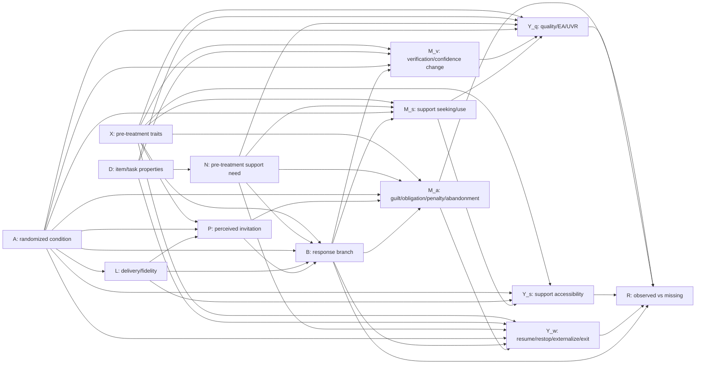
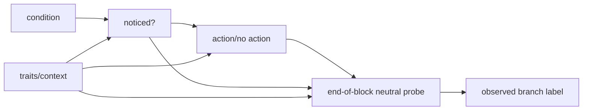
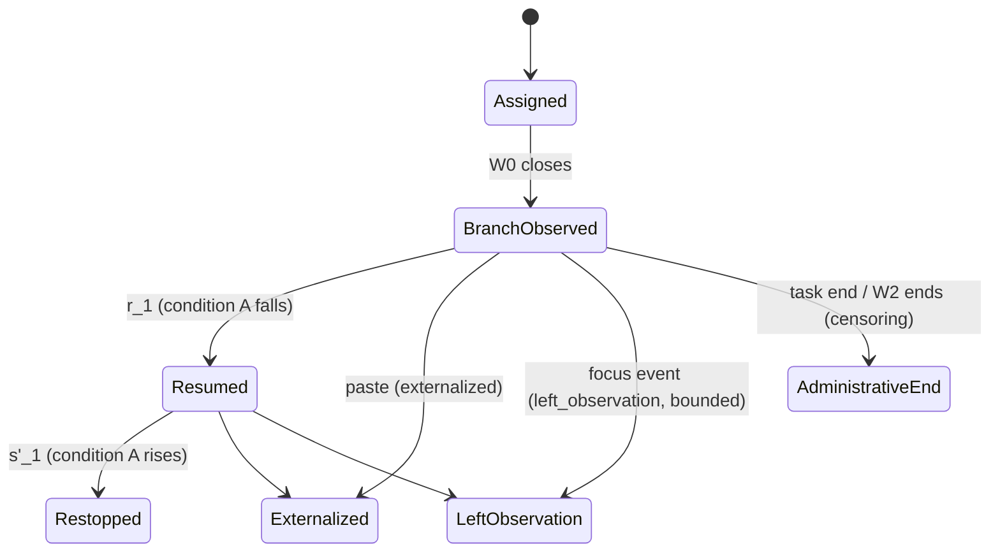

# EVAL-NCC 因果 DAG v0.1

> Status: pre-SSOT causal draft / 2026-09-17
>
> 目的は、割付前の要因と割付後の分岐・媒介・転帰を分離し、主要 ITT に post-treatment bias を持ち込まないことである。矢印は候補因果関係であり、採用済み理論や同定済み機序を意味しない。

## 1. ノード

| 記号 | 時点 | 内容 |
|---|---|---|
| `X` | 割付前 | 事前知識、AI 経験、Need for Cognition、良心性、社会的望ましさ、一般不安、アクセシビリティ需要 |
| `D` | 割付前 | item / task 難度、提案の正誤、検証可能性、誤りのもっともらしさ |
| `N` | 割付前 | その機会での実際の支援需要、主課題状態、時間圧 |
| `A` | 割付 | C0-C4 の実験条件 |
| `L` | 割付後 | 配信成功、表示、最低支援経路など実装忠実度 |
| `P` | 割付後 | 招待の知覚。気づいた／気づかなかった／不明 |
| `B` | 割付後 | 明示の受諾（★ 2026-09-19: 旧「受容」）、保留、拒否、見逃し、意図的無応答、判別不能無応答 |
| `M_v` | 割付後 | 検証行動、確信変更、摩擦完遂 |
| `M_s` | 割付後 | 支援探索・利用 |
| `M_a` | 割付後 | 応答義務、罪悪感、不利益予期、放置不安 |
| `Y_q` | 転帰 | 判断品質、誤受容、無検証依存 |
| `Y_s` | 転帰 | 支援到達可能性、支援 probe 成功 |
| `Y_w` | 転帰 | 再開、再停止、外部化、離脱 |
| `R` | 観測過程 | 自己報告・ログが観測されること。選択的無応答を含む |

## 2. 主 DAG

`A -> Y*` は、図に列挙しきれない直接経路と未測定媒介を含む総効果を表す。主要 estimand はこの総効果であり、`B/M*` で塞がない。

## 3. 主要 ITT の同定

無作為化が成立し、割付の干渉と重大な protocol contamination がないなら、`A` と各 `Y` の総効果に backdoor adjustment は不要である。精度向上のために調整する場合は `X/D/N` のうち割付前に測った変数だけを使い、未調整推定を併記する。

最小調整候補は次である。

- participant/block 固定効果または participant random intercept
- item 難度と提案正誤
- ベースライン判断品質
- 事前知識、AI 経験、NFC

良心性、社会的望ましさ、一般不安は罪悪感等の解釈と効果修飾に使えるが、標本が小さい形成的評価では過剰調整しない。

## 4. 調整してはいけないノード

| ノード | 理由 | 許される用途 |
|---|---|---|
| `L` | 割付後の実装忠実度。条件付けると delivery に関する selection を作る | 実装監査、CACE を行う場合の明示的 IV 仮定 |
| `P` | 割付後の知覚 | 操作確認、記述的 aware-set |
| `B` | 割付後の応答分岐 | 分岐分布、記述的 branch-specific outcome |
| `M_v` | 品質への媒介 | 機序分析。主要総効果では調整禁止 |
| `M_s` | 支援到達可能性・品質への媒介 | 機序分析のみ |
| `M_a` | 主要転帰でもあり、その後の行動への媒介 | outcome として推定。別 outcome の主要モデルへ無条件投入しない |
| `Y_w` | 競合転帰 | multi-state / competing-risk outcome として扱う |
| `R` | collider になりうる観測選択 | complete-case 選択を主要にしない |

特に `B` で条件付けて「再開者だけ」「応答者だけ」を比較すると、`A -> B <- N/X` の collider を開きうる。`R=1` のみを選ぶ complete-case も、`M_a/Y -> R <- X` を通じて偏る可能性がある。

## 5. 無応答の DAG

観測される `C=missed` は、`no action` かつ probe で `not noticed` と回答した場合だけである。probe 欠測時に `P` をログから補わない。`C` は真の潜在分岐の完全観測ではなく、測定規則に基づくラベルである。

## 6. Competing outcomes

> ★ **2026-09-19（J-10 / J-13）**: 状態名を SSOT の語彙へ対応させる —— `Resumed` = 産出の再開 `r_1`・`Restopped` = 再停止 `s'_1`（ADR-030 補訂 1 項目 7）／ `Externalized` = `externalized`（ADR-029・GSE の実体は `paste`）／ `Exited` は**分解する**: ウィンドウ離脱 = `left_observation`、課題終了・観測窓末 = 打ち切り（ADR-029 D5）。★ 2026-09-19: 図の辺を SSOT の語彙へ改め、旧 `Exited` を `LeftObservation`（focus 事象・⚠️ 競合と打ち切りの混合なので両極で上下界）と `AdministrativeEnd`（課題終了・観測窓末 = 打ち切り）の 2 本に割った。⚠️ 本人の明示終了の扱いは分析契約 §14 の未決。

再開、外部化、離脱は first-event 解析では競合する。AdministrativeEnd は競合転帰ではなく管理打切りである。再開後の再停止は再開を入口とする別 transition であり、再開した者だけの比較を主要効果へ戻さない。

## 7. 媒介分析を行う場合の境界

機序仮説は次のように分ける。

- `A -> M_a -> Y_w`: 応答義務等が行動分岐や離脱へつながる可能性。
- `A -> M_v -> Y_q`: 摩擦が検証を通じて判断品質へつながる可能性。
- `A -> M_s -> Y_s/Y_q`: minimum support が支援利用を通じて品質へつながる可能性。

自然直接・間接効果には mediator-outcome confounding がない等の強い仮定が必要である。初回 `EH4` では mediation を探索的に留め、主要結論を mediator adjustment に依存させない。interventional indirect effects を採る場合も、仮定と実装を別途事前登録する。

## 8. 効果修飾

事前候補は、Need for Cognition、事前知識、AI 経験、friction preference、アクセシビリティ需要、課題難度である。これらは `A` より前に測る。サブグループ内 p 値の有無ではなく interaction と区間推定を報告し、標本不足なら `unresolved` とする。

GR-H11 では NFC が高い層だけに利得が偏りうるため、平均効果が良くても最低層の誤受容・負担を別に確認する。個人差を理由に重い摩擦を事後的に対象外化しない。

## 9. 負の対照の役割

`C4 negligent relinquishment` は、「応答要求がないため罪悪感が低い」という観測だけでは C3 の成功を識別できないことを検査する。期待される弁別は次である。

| 指標 | C3 | C4 |
|---|---|---|
| 応答義務 | 低い | 低い可能性がある |
| 罪悪感 | 低い | 低い可能性がある |
| 支援到達可能性 | 保持 | 低い |
| 放置不安 | 低い | 高い |
| 判断品質 | 非劣性 | 悪化しうる |

C3 と C4 が支援到達可能性・放置不安で弁別できない場合、構成概念または操作が不成立であり、「両方とも返権」とまとめない。

## 10. 脅威と反証

1. **測定反応**: probe が応答義務を作る。全条件共通・ブロック末・任意回答で抑える。
2. **spillover**: 同一参加者が C1 の応答要求を学び C3 に持ち込む。条件順ランダム化、washout、between-subject 感度を使う。
3. **実装と説明の混同**: Semantic Stop の実処理と説明文の効果が混ざる。EH1 監査と利用者向け操作を分離する。
4. **低支援需要**: そもそも支援不要なら C3/C4 を弁別しにくい。標準 support probe を別に置くが、実需要と同一視しない。
5. **観測不能な検証**: 画面外の内的検証をログで否定できない。明示チャネルの行動指標と自己報告を併記する。
6. **選択的回答**: guilt が高い人ほど回答しない可能性。bounds と MNAR 感度で結論の反転を確認する。

## 11. 整合性検査

- `measurement-dictionary.md` の8概念とノード名が一致する。
- `eval-ncc-analysis-contract.md` の IAS、分岐、競合転帰、欠測コードと矛盾しない。
- `gr-h4-h9-h11-h12-falsification-table.md` の GR-H11 は EVAL-NCC の主要比較と独立したミニ実験である。
- AI Fatigue Scale は DAG の瞬間 mediator や `A` の入力に置かない。使用する場合は割付前傾向共変量または遅延追跡 outcome に限定する。
- `EH1`、`EH2`、`EH3+` の証拠階梯を混同しない。
