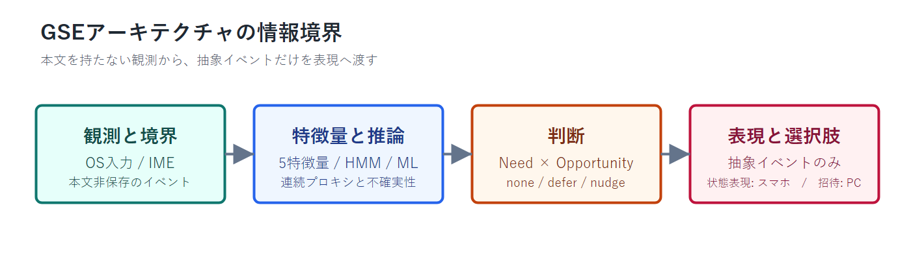
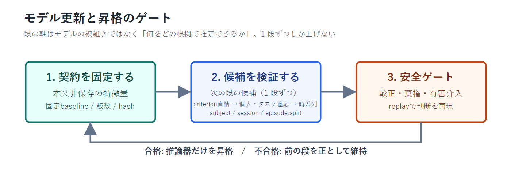
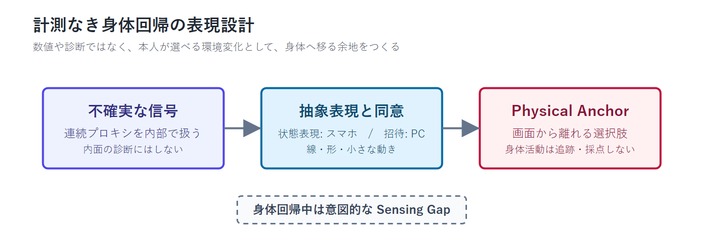

**Generative Struggle Engine (GSE)**

キーボード上の「迷い」を、本文を保存せずに推定し、メディア表現と身体的回帰への招待へつなぐ作業環境

ZEN大学（2026年4月入学）　三浦 尊統

本資料は、GSEの目的、設計哲学、アーキテクチャ、実装計画を説明する。本文の引用は著者名・年で示し、完全な書誌は『GSE参考文献』に置く。特徴量と推論の厳密な定義は『GSE技術設計書』、検証の詳細と実測値は『GSE検証レポート』を参照する。

# **1\. なにをつくるか**

生成AIは、答えを得るまでの時間を短くした。しかし、答えを受け取ることと、自分で問いを構成し、試し、間違いを直すことは同じではない。私がChatGPTの生成コードを貼り付けて問題が解決したときに感じたのは達成感ではなく、「自分はAIのオペレーターになったのではないか」という空虚さだった。

私はもともと、速く、正確に、皆と同じように進めることを求められる環境にうまく適応できず、効率という物差しに劣等感を持っていた。生成AIはその苦手だった作業を一瞬で代替してくれるはずだったが、実際に起きたのは能力の回復ではなく、考える過程の外部化だった。エラーが消えた瞬間に残ったのは「自分は何を理解したのか」という問いであり、この違和感がGSEの出発点になった。

この問題を当初は「AIを使うと認知資源が消耗する」と考えた。しかし、努力感の操作と課題成績の関係を再検討した事前登録研究では、強い努力操作が抑制能力そのものより反応の慎重さや課題からの離脱に影響した（Lin et al., 2020）。また、生成AI利用者への調査では、批判的思考の重心が生成から検証・統合・タスク管理へ移ると報告されている（Lee et al., 2025）。AI支援コーディングの生体計測研究にも、生成努力の外部化と認知的関与の低下に整合する指標が報告されているが、これはGSEの有効性の証明ではなく、問いの出発点である（Burelli et al., 2026）。GSEが扱うのは疲労の量ではなく、**自分で考え続ける関与の機会がどこで外部化されるか**である。

GSEは、AIを禁止する道具ではない。AIや検索へ答えを渡す直前に、本人が自力で考え続ける余地が残っているかを、作業の形から推定する。必要なときだけ、画面上の小さな表現や画面から離れる招待を差し出す。目的は生産性の最大化ではなく、**自力で解く機会を外部知能が先回りして消してしまわないこと**である。

## **【対象】**

対象は、WindowsまたはmacOS上で日常的にキーボード作業を行う知識労働者である。論文、レポート、仕様書、設計書、メール、プログラムなど、画面の前で言葉と論理を組み立てる作業を広く含む。観測は特定のアプリに閉じない。OSレベルで打鍵の形を捉えるため、被験者には普段の作業環境をそのまま使ってもらう。

**ただし、問いの広さと主張の広さを分ける。** 観測を広く取ることと、検証済みだと言える範囲を広げることは別である。本フェーズで確証的に検証するのは論述作業に限る。動画編集や図面作成へそのまま拡張するとは主張しない。入力モダリティが変われば、ドメインアダプタと特徴量の再設計が必要になる。**先行研究が無いことは、問いを狭める理由にはしない。同時に、有望である根拠にもしない。** 過大な主張を防ぐのは問いの狭さではなく、どこまでが検証済みかを段ごとに明示することである。

## **【設計哲学】**

GSEは「状態を当てて行動を最適化する系」ではなく、不確かな信号を、本人が考え直せる環境へ慎重に接続する系である。設計上の約束は次の五つである。

1. **内容ではなく、作業の形を見る**: 本文、クリップボード本文、ウィンドウタイトルを保存せず、打鍵間隔、訂正、貼付、IME状態、フォーカス遷移など、行動の構造だけを扱う。
2. **推論を診断へ変換しない**: 推定値は内面の断定ではない。証拠が足りないときは、表現も介入も弱め、本人に別の解釈を残す。
3. **考えている最中の苦闘を守る**: 「支援が必要か」と「いま割り込んでよいか」を分ける。`none` と `defer` は、介入を控えるべきという正しい出力である。
4. **表現は、数値ではなく環境の差にする**: `p_stuck` や「停滞中」というラベルを見せず、状態の変化を周辺の短い視覚的な差として置く。
5. **身体的回帰は、採点しない選択肢にする**: 画面から離れることを提案しても、開始、継続、歩数、距離、完了を測らない。系が成功を宣言するのではなく、本人が行動を選ぶ。

GSEは、作業の内容を読む代わりに形を観測し、不確かな推論をいきなり助言へ変えない。観測、推論、判断、表現を分け、最終的に渡すのは「診断」ではなく、本人が選べる小さな環境の変化と招待である。

# **2\. どんな出し方を考えているか**

## **【公開と提供方法】**

プロトタイプはWindowsとmacOSに対応するOSSとして公開している。GSEはエディタではなく、**普段の作業環境の背後で動く常駐アプリ**である。したがって提供の単位は「特定のアプリの中で使うもの」ではなく、本人が普段使っているアプリのまま動くビルドになる。

このため、収集は二つの形を取る。**統制実験では、入力先を実験専用の記入ページ内の単一の入力欄に固定する。** これは実務の都合ではなく統制である。オートコレクト、赤波線、自動補完が働くと訂正行動そのものが変わり、訂正率に統制外の交絡が入る。ページ側でこれらを属性で切り、加えて拡張機能の入っていないブラウザプロファイルで開く手順を置く。**ただし属性で抑止しきれない拡張があり、在宅条件ではその統制を検証できない。これは限界として報告する。****一方、自然作業の長期記録では入力先を固定しない。** 普段の仕事を普段どおり行ってもらい、アプリをまたいで行動の形を記録する。**どのアプリを使っていたかは記録しない**ため、後から特定のアプリだけを選り分けることもできない。

未踏期間中は、統制実験に使ったビルドと再現スクリプトを公開する。成果物は、匿名化した日本語IME入力データセット、モデル更新とリプレイを再現できる技術基盤、状態表現と身体的回帰への招待を含むHCIプロトタイプの三つに分ける。

## **【アーキテクチャ】**

GSEは処理を七層に分ける。各層は「観測できること」「推定したこと」「本人へ提示すること」を混ぜないための境界である。

| 層 | 役割 | GSEで扱うもの |
| :--- | :--- | :--- |
| 0 | セッション文脈 | 作業の種類、支援への同意、表示設定 |
| 1 | ドメインイベント | Writing等の操作イベントへの変換 |
| 2 | プライバシー境界 | 本文を除去したイベント封筒 |
| 3 | ドメイン特徴量 | 打鍵間隔、訂正、バースト、休止、IME境界（推論に入るのはここまで）。別枠でポインタ活動・フォーカス遷移を記録 |
| 4 | 作業状態プロキシ | 摩擦、前進、詰まりらしさ、不確実性 |
| 5 | Opportunity | ブレークポイント、受容性、クールダウン、拒否履歴 |
| 6 | Decision / Expression | `none`、`defer`、`nudge`、状態イベント、招待 |
| 7 | Outcome / Harm | 自力復帰、外部化、煩わしさ、自律性、再利用 |

現行のプロトタイプは、Writing向けの入力、5特徴量、HMM、ヒステリシス、NudgeまでをRustとReactで動かしている。将来の学習モデルを追加しても、層3の特徴量契約と層5・6の介入境界を壊さない。

## **【観測しているチャネル】**

**観測は打鍵だけではない。** 打鍵に加えて、ポインタの活動量（移動量・押下回数・ホイール回数を1秒ごとに量子化した粗いカウント）、フォーカスが切り替わった時刻、貼り付けの文字数、IMEの状態を、いずれも本文を持たない形で記録している。**座標も、押されたボタンの種別も、スクロールの向きも、切り替え先のアプリも記録しない。**

**なぜ打鍵以外を観測するのか。** 打鍵が途切れた区間を「離席」と読むと、**マウスで進めている作業を離席と誤分類する。** 図面を触る、資料を読む、動画を編集するといった作業は打鍵がほとんど発生しない。OSが提供する最終入力時刻はマウスを含むため、この二つを原理的に分離できない。ポインタの活動量を別チャネルとして持つのは、**沈黙の中身を割るためであって、推定の精度を上げるためではない。**

**そして、これらは推論に入れていない。** 現在の推論に流れるのは打鍵由来の5特徴量だけであり、非打鍵チャネルは**記録のみで、推論器へ1バイトも渡していない**。観測を増やせば当てられるようになるという主張には、この分野の先行研究がむしろ否定的な記録を残している（Freihaut & Göritz, 2024）。**まず何が観測できるかを確かめ、寄与を測ってから配線する。** 順序を逆にしない。

図1は各層を通過する情報の境界を示す。推論側では連続値を使うが、表現側へ渡すのは意味を限定したイベントだけである。



**図1　GSEアーキテクチャの情報境界。**

## **【内部ワークフロー】**

GSEの内部では、(1) OS/IMEの操作を本文を含まないイベント封筒へ変換し、(2) 30秒窓の特徴量と個人内基準を更新し、(3) HMMまたは候補モデルが連続プロキシと不確実性を出し、(4) NeedとOpportunityを別々に判定し、(5) 許可されたときだけ抽象イベントを表現チャネルへ送る。表現後の受容・拒否・有害性は、次のモデル更新時にだけ評価へ戻り、表現チャネルから推論器へ直接フィードバックしない。

この流れには、結論を急がないための停止点を置く。不確実性が高い、入力が継続している、クールダウン中、または拒否履歴がある場合は`defer`または`none`を出す。**根拠が足りないときに何をするかは §3 の縮退設計に一括して書く。**

## **【推論のアーキテクチャ】**

### **基準モデル: Writing HMM**

最初に使うのは、Rustで再現できるルールとHMMである。30秒のローリング窓から、打鍵間隔の中央値、訂正率、バースト長、休止回数、削除後の休止率を抽出し、個人内の基準値で正規化する。HMMはForward Algorithmで状態の連続信号を更新し、`p_stuck` と不確実性を出力する。

このHMMは「人間の認知状態を三分類するモデル」ではない。Writing入力に対する再現可能なbaselineであり、後段のモデルや表現が何を改善したかを比較するための基準である。

### **段を上げる軸は「モデルの複雑さ」ではない**

**当初の計画は、ルール＋HMMからロジスティック回帰、勾配ブースティング、1D-CNNへとモデルを複雑にしていく梯子だった。この軸は降ろした。** 理由は、この方向に負の記録が並んでいるためである。デスク行動から状態を推定する研究では、入力特徴を足したモデルが帰無モデルより予測性能を下げた報告があり、著者は情報量のない特徴によるノイズへの過適合と述べている（Freihaut & Göritz, 2024）。同じ著者らは別の研究で、マウス軌跡を画像化したCNN回帰の決定係数が負に振れたとも報告している（Freihaut & Göritz, 2021）。臨床予測モデルの71研究282比較の系統的レビューでは、バイアスの低い145比較において機械学習とロジスティック回帰のlogit(AUC)の差が0.00だった（Christodoulou et al., 2019）。ただし比較対象に系列深層モデルは含まれない。決定的なのは評価法との比の問題で、ある内部比較ではアルゴリズム間の差が最大12ポイントであるのに対し、交差検証を被験者単位に変えると31ポイント落ちた（Koldijk et al., 2018）。**複雑化で得られる幅より、正直に評価して失う幅のほうが大きい。**

**そこで段を、何をどの根拠で推定できるかで並べ直した。**

| 段 | 何を推定するか | 主な候補 |
| :--- | :--- | :--- |
| 固定baseline | 観測パイプラインと時間的プロキシを確立する | 現行ルール＋Writing HMM（現在地） |
| criterion直結 | 状態名ではなく、観測できる自力前進の帰結を予測する | 正則化ロジスティック回帰、離散時間ハザード |
| 個人・タスク適応 | 個人差とタスク差を吸収する | 階層モデル、ドメイン別ヘッド |
| 時系列 | 時間的な競合と系列構造を扱う | 離散時間の競合リスク、ROCKET系 |

順序は名前ではなく昇格ゲートが担う。**投資すべき方向は複雑化ではなく個人化だと見ている**——打鍵特徴のみの個人化モデルが集約モデルより被験者間のばらつきを抑えた報告があり（Ghosh et al., 2017）、被験者識別子を加えるだけで回帰の相関が大きく上がった例もある（Koldijk et al., 2018）。**ただし前者はスマートフォンのタッチ入力であって物理キーボードではなく、後者は課題によって効き方が逆転する。そして同じ論文は、PC操作と生理指標だけでは利得が出なかったとも報告している。個人化を確定した処方としてではなく、最初に試す方向として置く。**

**MultiROCKET + Hydra は最終段の第一候補であって、次にやることではない。** 深層モデルへ直行せず、学習不要のランダム畳み込み特徴を線形ヘッドへ渡す構成を選ぶのは、少データでの不安定性を避けつつ criterion 直結 と地続きで比較できるためである（Dempster et al., 2020; Middlehurst et al., 2024）。ただしこれらは一般時系列ベンチマークの結果であり、GSEの弱い行動ラベルへの直接的な証拠ではない。

**そして段を上げる前に、観測空間の穴を埋める。** 記録側は語・文の境界キーを保持しているのに、推論側がまだ使っていない。特徴を増やす前に、既に取れているものを使い切る。損失関数の定義は『GSE技術設計書』に置く。設計上の順序として、**損失を先に決めて状態名を後から合わせるのではなく、何を観測結果として予測したいかを先に定義し、その結果に合う損失を選ぶ**。

### **モデル更新と昇格**

モデル更新は次の順に行う。

1. 本文を含まない特徴量スナップショットと作業上の結果をローカルで収集し、Rustの特徴量定義と同じ入力でPython側の候補を学習する。
2. 隣接するローリング窓を大量の独立標本として数えず、被験者・セッション・Decision Episode単位でホールドアウトする。時系列の隣接窓は統計的に独立でなく（Hammerla & Plötz, 2015）、少数標本での誤差幅も大きくなり得る（Varoquaux, 2018）。
3. AUCや正解率だけでなく、Brier score、calibration、欠測時のabstention、介入悪化率を確認する。
4. データハッシュ、特徴量スキーマ、学習条件、モデル版数を記録してゴールデンセッションをリプレイし、合否ゲートを通らない候補は採用せず直前のモデルを維持する。



**図2　モデル更新と昇格のゲート。** 候補は本文非保存の特徴量契約を共有し、被験者・セッション・Decision Episodeを分けた再現評価と安全ゲートを通ったときだけ昇格する。

**段を上げること自体を成果にしない。** 「モデルが複雑になった」ではなく、**確率の較正と介入判断が改善し、しかも誤介入が増えない**ことを示せたときだけ更新する。ONNXを使う場合も、Rust側の`FeatureExtractor`の契約は保ち、推論器だけを差し替える。

# **3\. 斬新さの主張、期待される効果など**

## **【既存ツールとの差分】**

既存の集中支援ツールは、時間、アプリ利用、操作量を可視化して作業を効率化する。一方GSEは、操作量が少ない区間を単純に「怠け」や「離席」とみなさず、詰まりらしさと介入機会を分けて扱う。差分は、推定器の精度だけでなく、推定結果をどのように人へ返すかにある。

**最も近い先行は、生産性ツールではなく執筆過程研究の側にある。先に開示する。** 打鍵ログを30秒の移動窓で切り、特徴量を抽出してHMMで潜在状態を推定し、それを「待機／文章化／推敲」と解釈した研究が既にある（Uto et al., 2020、被験者72名）。**窓幅30秒・ステップ幅10秒という設定までGSEとほぼ同型である。** したがって**「打鍵とHMMで執筆過程を推定すること」自体をGSEの新規性として主張しない。**

**残る差分は三つである。** 第一に、その研究は**IMEを一語も扱っていない**——結果のテキストだけを見ることでIMEを迂回しており、論文には変換も未確定文字列も出てこない。第二に、**事後の教育フィードバックが目的であり、その場の介入判断へ接続していない。** 第三に、テキストを読む設計であって、本文非保存ではない。

AI支援コーディングでは、全体の主観的負荷が下がっても、出力をほぼ検証せず受け入れると正答率が下がる可能性が報告されている（Fan et al., 2026）。このためGSEは「負荷が高いか」だけで介入せず、検証や訂正へ戻れる機会が残っているかを、行動プロキシとOpportunityの組合せで扱う。

| 観点 | 時間・アプリ計測型 | 忙しさ表示型 | GSE |
| :--- | :--- | :--- | :--- |
| 見る対象 | 時間・利用量 | 操作量 | 本文を含まない作業の形 |
| 沈黙の扱い | 対象外 | 低活動として扱う | 熟考・停滞・離席を分ける問い |
| 介入 | 計画・通知 | 中断可否 | NeedとOpportunityを分離 |
| 表現 | 数値・履歴 | 忙しさの表示 | 抽象的な状態変化 |
| 身体との接続 | 計測・達成 | なし | 計測なき身体回帰への招待 |

## **【縮退設計と多層的な価値創出】**

GSEの価値は、推定が常に当たることだけに置かない。本人には、本文を渡さず、数値や診断を見せず、拒否や見送りを正当な結果として扱う作業環境を提供する。開発・運用側には、特徴量、推論、判断、表現を分けたことで、誤りを一つの「AIの誤判定」にまとめず、どの層を修正すべきかを再現可能に検討できる。研究側には、本文非保存の行動プロキシ、Decision Episode単位の評価、モデル更新を止める合否条件を組にした検証方法を残す。

**フェイルセーフの向きを先に決めておく。** 根拠が足りないときに別の強い介入へ逃げるのではなく、**分からないときに静かにすること、更新できないときに前の検証済みモデルを保つこと**を既定にする。

| 根拠が不足した場所 | 縮退・維持するもの | なお残る成果 |
| :--- | :--- | :--- |
| 追加特徴量が取得できない | 基本5特徴量とHMM | content-freeな特徴量契約と再現基盤 |
| 統制条件でも高摩擦と低摩擦を分離できない | 推論を主張しない可視化ツールへ縮退する | 「content-freeな打鍵動態だけでは統制条件下ですら摩擦を分離できない」という、この分野への明確な報告 |
| 較正が個人差を吸収できない | 特徴量・プローブ設計・対象タスクを見直す | どの特徴量が主観と対応し、どれが対応しなかったかの除外実験の結果 |
| 候補モデルが昇格条件を満たさない | HMMを継続し、候補は研究用に固定 | 較正・棄権・誤介入を含む比較結果 |
| 推定は当たるが介入が有害 | 介入機能をGoとせず、推定の可視化と`defer`の記録に留める | 「推定が当たっていても介入が有害でありうる」ことの実証。適応的介入の設計に直接効く |
| 表現や招待が煩わしい | 当該チャネルを停止し、状態に応答しない基層へ縮退する | 受容性・自律性・害の評価結果 |

**ただし「撤退しても知見が残る」を言い訳にしない。** データ不足による空振りは反証ではなく測定の失敗である。統制タスク実験を入口に置いたのは、まさにその空振りを設計で避けるためである。

## **【展開可能性と学術的還元】**

最初の対象はWritingである。ほかの作業へ広げる際は、層1のイベント変換と層3の特徴量をその作業に合わせて再設計し、同じ検証をやり直す。したがって「モダリティを差し替えれば使える」とは主張しない。一方で、内容非保存の境界、推論と表現の分離、NeedとOpportunityの二段階判断、棄権を含むモデル昇格という枠組みは、別ドメインでも再利用できる。

本フェーズでは、同意を得た範囲で匿名化した日本語IMEの特徴量データ、特徴量スキーマと再現スクリプト、本文非保存の信号をメディア表現と計測なき身体回帰へ接続するHCIプロトタイプを成果として整える。**還元先は次の四つである。**

**(1) 日本語IME環境の打鍵データセット。** **主張の範囲を先に狭めておく。** 日本語を打った打鍵ログの公開物は存在する（ENJA15、英日翻訳・55時間超）。また本文を保存せずに打鍵データを公開した先例も複数ある。**したがって「日本語の打鍵データが無い」とも「本文非保存だから公開しやすい」とも書かない。** 確認できたのは、**IMEを扱える既存手法がいずれも本文を保存する**ことである——Translog-IIは自前エディタの中でしか動かず、Hylogは未確定文字列を取るために本文の読み取りへ全面的に依存する（Crotti et al., 2026。対象は簡体字中国語）。**IMEを扱う能力と本文非保存は、既存のどの系でも両立していない。** なお「IMEの変換過程を含む公開データセットが見当たらない」は取り下げた——ENJA15の公開XMLに変換過程が残っていた。**差分は文献の不在でも公開データの不在でもなく、内容非保存・一般アプリ横断・自然作業・未来の回復への接続の側にある。** 加えて、実装で踏んだ差を示す。**日本語入力では、変換セッションが推定窓の約56〜60%——IME使用が特に多い実データでは94%——を覆う。** 当初はこの区間で推論を止める設計だったが、それは日本語入力のときだけ推論を止めることに等しく、撤回した。**これは自前の実測である。** またベースライン定数は、日本語IME入力で観測される打鍵間隔の典型域（100〜130ms）の下端に100msを置く一方、ラテン直接入力側は英語圏の大規模コーパス（Dhakal et al., 2018）由来の150msを採っている。**単一の定数では両者を同時に正しく採点できない。前者は自前の較正値、後者は文献値であり、一つの尺度に畳めないこと自体が日本語環境の固有性である。**

**(2) 計測なき身体回帰の、結合側の空白。** 打鍵動態だけから本人の精神運動状態をcontent-freeに事後推定する近傍系は既に存在する。睡眠慣性を誘発した統制実験でAUC 0.93 / 0.91、逐語で「タイプされたテキストの内容や言語によらず」とされる（Giancardo et al., 2015、被験者14名）。**ただしこれは悪化の検出であって回復の検出ではなく、日本語は検証されていない。** **新しいのは推定ではなく、その推定を採点しない表現へ結合して常在させることである。** 探索の角度を変えて検算しても、結合側の系は見つかっていない。**主張をこの一点に絞るのは新規性の縮小ではなく焦点化であり、査読に対して強くなる方向である。** ただし空白は有望を意味しない。

**(3) Decision Episode単位の評価と、棄権を含む昇格ゲート。** 30秒窓を1Hzで出すと隣接窓の29/30が重複するため、窓を独立標本として数えない。**「推定が当たっていても介入が有害でありうる」を分けて測る設計**は、適応的介入の分野に直接効く。

**(4) 本文非保存のまま判断を再現できる検証基盤。** ゴールデンセッションをCLIで再実行し、特徴量と判断の回帰を検出する。**推論の挙動を変えたら版数を上げてゴールデンを再生成する**規約とセットで運用する。

学術的な問いは、本文を読まずに得た行動プロキシが個人内の作業上の結果とどこまで整合するか、そして不確実な信号を診断にせずに表現できるか、の二点である。

## **【状態からメディア表現へ】**

推論層の連続値を、そのまま画面やスマートフォンへ送らない。表現チャネルに渡すのは、状態の変化を表す抽象イベントだけである。

```text
level: stable / friction_rising / stuck
invitation: none / present
seq: 単調増加する番号
emitted_at: 秒単位の時刻
epoch: チャネル世代
```

`p_stuck`、本文、キー列、位置情報、端末名は境界を越えない。表現チャネルは推論や介入判断を行わず、受け取ったイベントを媒体固有の表現へ変換する。

この分離により、モデルの確率をそのまま「あなたは停滞している」という心理的な診断へ変換しない。推論層は不確実な信号を出し、判断層は提示の可否を決め、表現層は変化を見える形にする。どこで誤りが生じたかを個別に検証できることが、GSEのメディア設計の前提である。

## **【表現の配置——面を役割で分ける】**

**同じ面に全部を載せない。第1版では、常時の状態表現をスマートフォン側に置き、差し出しをPC側に残す。**

**まず、文献では決められないことを明記する。同じ知らせを「作業中のデバイス」と「別デバイス」に出して比較した実験は存在しない。ここは自分で実験しない限り埋まらない。** その上で、片側にだけ実証がある。**常時の状態表現はスマートフォンの常在面に置く。** 主課題と同じ画面に周辺表示を重ねると、離散的に出す最良の条件でも主課題の成績が26%、連続して動かすと43%落ちる。しかも記憶率には差がない（Maglio & Campbell, 2000）。**払う代償に見合う対価が観測されていない。** なおGSEの招待は状態が変わったときだけの離散提示であり、この研究の最良条件側に相当するため、代償の量は小さいと見込む。**これは推論であって実証ではない。** ロック画面のように本人が偶然目にする面では、2秒程度で状態の変化を読み取れる層と、本人が開いたときに数十秒見られる層を分ける。色だけを主符号にせず、形の変化を組み合わせる。表現の受容性と弁別性は、外部研究の効果を借りず、GSE自身の試視と受容試験で確認する。

**一方、画面から離れる招待はPC側から差し出す。** 理由は三つある。第一に、本人は既にPCの前にいる。第二に、**PC側には提示を拒否したことを記録する機構が実在する**——スマートフォン側に置くと受容も拒否も自己申告になり、評価が成立しない。第三に、境界を一方向に保てる。スマートフォン側で選ばせると逆方向の通信が必要になり、位置情報の取り扱いという別の問題が開く。**表現面は気づき、差し出しはPC**という役割分担である。Nudgeも同じ理由でPC側に置く。

ここで重要なのは、メディア表現を「認知状態の可視化」と呼ばないことである。表現されるのは、本文非保存の行動プロキシから得た、現在の作業に関する不確実な信号である。本人が別の説明を持つ余地を残す。

## **【スマートフォンOSの制約と、第1版での越え方】**

**この設計には、実装可能性の壁が実在する。OSベンダの公式ドキュメントを一次で当たった結果、iOSとAndroidは能力が正反対だった。**

| | iOS | Android |
| :--- | :--- | :--- |
| ロック画面ウィジェット | 使える | 依存できない（標準で無効・保証もされない） |
| ライブ壁紙 | 仕組みが無い | 使える |
| 持続アニメーション | 公式に支持されない（最大2秒・連続更新非対応） | 画面が点いている間だけ可 |
| 常時表示画面での挙動 | 描画はされるが輝度が落とされ、アニメーションは実行されない | 描画されない（必要な権限が非公開） |
| 色 | OSが強制的にモノクロ化する（一部の型は例外） | 自由 |

iOSでは、常時表示中はアニメーションが一切実行されない。更新間隔の推奨は約5分以上、リロード回数は典型的に1日40〜70回とされる。**秒オーダーの判定をそのまま写すことはできない。** さらにロック画面のウィジェットは強制的にモノクロ化されるため色相が使えず、色の符号としては明度だけが残るが、**常時表示はその明度をさらに削る。** つまり常時表示の有無が被験者間の交絡になる。Androidは画面が点いている間なら自由に描けるが、常時表示には載らず、機種ごとの差も残る。

**向き合い方は決めてある。** 第一に、**OSによって符号が変わる設計を採らない。** 振動的な動きは両OSで等価に出せないため第1版の符号から外し、両方で同一に実装できる静的な符号——面の縁が開くか閉じるか——に差し替える。**同じ意味が端末によって別の見え方になると、OSが表現と交絡して評価が壊れる。** 第二に、表示面をOSごとに分ける。iOSはロック画面ウィジェット、Androidはライブ壁紙を使う。第三に、**受容性は実機で確かめる。** 試作した試視ハーネスは振動符号と静的符号の両方を実装してあり、どちらに転んでもデータが取れる。**ただし本番の試視はまだ実施していない**——最初の試行は刺激が画面外に出ており、無効として破棄した。常時表示中の挙動と機種差は、実機マトリクスでの確認を実装着手の前提条件に置く。

**隠さずに書くべき代償がある。** iOSでは、「外部サーバを経由しない」「被験者のPCに常設の受信待ち受けを置かない」「背景で受信し続ける」の三つを**同時に**満たす経路が存在しない。GSEは被験者のPCを常設サーバにしない方を採るため、**iOSでは状態が変わった時刻とその値がプラットフォーム事業者を経由する。** 加えて、**送信のための資格情報を被験者のPC側に置くことになる。** その鍵をどの範囲で共有するかはまだ決めていない——**研究全体で一本の鍵にすると、他の被験者の端末識別子を知る者が任意の被験者へ送信できてしまう。** ここは実装前に閉じる。**Androidは外部を経由しない代わりに、PC側に受信のための口を開ける必要がある。** 常設にはせず、転送のたびに開いて閉じることを既定とする。**どちらのOSにも代償があり、種類が違うだけである。** 本文を送らないという原則は守れるが、**変化のタイミングを漏らさないことは守れない。** Androidでは外部を経由しないためこれは起きない。この非対称は同意文書にOS別に明記する。

## **【表現からPhysical Anchorへ】**

GSEにおいてPhysical Anchorは、MLのスコアを高い段階へ送る装置ではない。表現が「自分の状態を見張られている」という感覚へ変わらないよう、必要なときだけ、**画面から離れるという別の選択肢**を提示する出口である。



**図3　推論から身体的回帰への表現設計。** 連続プロキシを抽象イベントへ変換し、本人の同意を経て、身体活動を追跡・採点しないPhysical Anchorを提示する。身体回帰中には意図的な観測の空白を置き、復帰後にだけ本文非保存の作業行動を再び観測する。

これは「歩けば作業が改善する」という主張ではない。歩行を検出して評価するのでもない。**必要なのは「歩いた」という事実ではなく、外部知能の答えを受け取る以外の行動を本人が選び直せる余地である。** このためPhysical Anchorは、開始も継続も完了もシステムの成功条件にしない。これが**計測なき身体回帰**である。

身体活動を促す既存のシステムには、歩数や移動を計測し、抽象化して表示することで活動への気づきを支える設計がある（Consolvo et al., 2008）。一方、個人の行動を数量化すること自体が、楽しさや自律的な関与を損なう場合がある（Etkin, 2016）。また、短い休止が活力や疲労感に関係し得るというレビューはあるが、すべての作業成績を改善する証拠ではない（Albulescu et al., 2022）。**GSEはこの緊張関係を踏まえ、あえて測定しない側に倒す。**

したがって、Physical Anchorはセンサ、タイマー、歩数目標、完了表示を持たない。身体回帰の最中は、意図的にセンシングを止める。これは「何も測らない」のではなく、**身体活動そのものを追跡・評価・最適化しない**という設計上の空白であり、復帰後の最小限のcontent-freeな作業行動だけを再び扱う。反省を促す技術は、情報を増やすよりも、利用者が自分の状況を別の角度から捉え直せる余白を設計する（Sengers et al., 2005; Hallnäs & Redström, 2001; Baumer, 2015）。効果を先取りせず、招待の受容と、その後に自力で考える機会が保たれたかを分けて検証する。

# **4\. 具体的な進め方と予算**

GSEは、推定、表現、介入、身体的回帰を一つの効果量にまとめない。

| 検証対象 | 問い | 指標 |
| :--- | :--- | :--- |
| 観測・推定 | 本文非保存の特徴量は、個人内の作業上の結果と順序一致するか | C-index、較正、Brier、欠測率 |
| 介入判断 | 必要なときだけ提示し、進行中の作業を悪化させないか | 有害介入率、見逃し率、defer率 |
| 表現 | 状態の変化を短時間で区別でき、過度に煩わしくないか | 弁別試験、視線・受容評価、拒否率 |
| 身体的回帰 | 本人が招待を選べる形になっているか | 招待の受容、機会保存の行動指標 |

本フェーズで主張するのは、**本文を保存しない作業プロキシから、介入判断に使える連続信号を作り、表現と選択肢へ接続できること**である。主張しないのは、キーストロークから内面を正確に読めること、摩擦が学習能力を高めること、歩行が成績を改善すること、常在面そのものに効果があることである。

## **【検証ワークフロー】**

最初の2か月は統制タスクで高摩擦・低摩擦の条件を比較し、観測空間が足りるかを見る。次に、個人差を吸収できる較正設計と自然作業のデータ収集を行う。その後、HMM baselineと候補モデルを比較し、介入あり・なしのクロスオーバーで、提示と見送りを分けて評価する。表現は状態表現と招待を分離した試作から始め、弁別性と受容性を確認してから運搬路を広げる。

**この計画が実行可能である根拠**: 判定を後から動かせなくする仕掛けは先に作ってある。事前登録は改訂のたびに「この改訂で合格が容易になっていないこと」の記載を必須にし、そう言い切れない改訂はそう明記して残す。解析ツールは、操作チェックを先に見るという凍結した順序を満たさない限り、条件ラベルに依存する量を出力しない。どうしても見るなら、その回を探索的として扱う印が結果に刻まれる。収集ログはその時点のビルドが何を記録できたかを自己記述するので、空白区間を「信号が無かった」「計器が無かった」「判定できない」に切り分けられる。三つとも提案上の宣言ではなく実装であり、到達点と未達は『GSE検証レポート』に分けて書いた。

**開発場所・時間帯・時間数**: 自宅またはコワーキングスペースで、主に日中（9:00〜18:00）に作業する。約9か月、1日7時間・月20日を基準に、約1,260時間を充てる。

## **【開発環境・使用言語・開発手法】**

Rust（Tauri 2.0）でOS入力、IME解析、特徴量抽出、推論、介入判断を実装する。TypeScript（React）でエディタとPC表現を作る。Pythonはオフライン解析、学習、較正、再現スクリプトに限定する。候補モデルを採用する場合はPyTorchからONNXへ出力し、Rust側でCPU推論する。スマートフォン側はDart（Flutter）で実装し、抽象状態イベントの受信と表現を担う。センサと位置情報は本体へ渡さない。

**開発手法**: 実験は乱数seed、lockfile、入力データのハッシュ、推論エンジンの版数を固定する。ゴールデンセッションをCLIで再実行し、特徴量と判断の回帰を検出する。学習・推論・評価の各境界を保つことで、モデル更新後も再現性と本文非保存を維持する。

# **5\. 提案者の腕前を証明できるもの**

GSEは、サーヴェイ、理論整理、RustとTauriによる実装、Windows・macOSの入力処理、他者を含む較正データ収集までを一人で進めてきた。現在は、5特徴量抽出 → 個人内正規化 → 2軸プロキシ → HMM → ヒステリシス → 介入判断という一連のプロトタイプが動作している。

**証拠に従って降ろしたもの。** 2026年度の提案から、次の主張を取り下げた。いずれも、思いつきで変えたのではなく一次資料に当たった結果である。

| 降ろした主張 | 取り下げた理由 |
| :--- | :--- |
| 認知資源が消耗するという枠組み | 事前登録の多施設再現で効果量がほぼゼロだった。しかも操作チェックは成功しており、努力感は大きく動いていた（Vohs et al., 2021）。効いていないのは「消耗から成績低下への連結」のほうである |
| 4段階介入と全画面ブロック | 画面を塞ぐ介入は「答えの受領」だけを狙えない。事前登録つき現場実験では、答えを出すAIは学習成果を下げたが、ヒントに変えたAIの害はゼロだった（Bastani et al., 2025）。全画面ブロックはこの区別を構造的に持てない |
| Flow / Incubation / Stuck の3クラス分類 | 脳内状態を読めるとは主張しない。実運用で使うのは連続信号と、それを消費する介入判断である |
| 歩行で発散的思考が60%向上する | 短い休止のメタ分析で作業成績は全体として有意でなく、認知負荷の高い課題ではむしろ負に振れた（Albulescu et al., 2022）。かつ歩行に特化した推定値は存在しない |
| モデルを複雑にすること自体を目標に置くこと | 複雑化で得られる幅より、評価法を正直にして失う幅のほうが大きい（Koldijk et al., 2018）。バイアスの低い比較では機械学習とロジスティック回帰の差が0.00だった（Christodoulou et al., 2019） |

**4番目は自分の動機に最も近い主張だった**（§7）。それでも、効果として主張できる証拠が無いので降ろした。全10項目と各項目の一次証拠は『GSE技術設計書』§0に置く。

重要なのは、動くデモだけでなく、測定設計が成立しなかった実測を原因分析へ戻せることである。被験者5名・40セッションの較正では、回答率のゲートは通過したが、モデル判定に必要な母数が足りなかった。**原因は推論側ではなく、較正プローブの負荷が個人差に対して一律すぎたことだった。** 結果として主観申告の回答分散が枯れ、ある被験者はプローブを「多すぎる」と答え続けた末に同じ値を答え続けた。**最も痛いのは、事前アンケートでAI依存を最上位——ほぼ毎回、生成物のコピペは1日複数回——と答えた、GSEが最も狙うべき層の被験者が、回答率0.333と5名中最低で、主観ラベルを事実上供給できなかったことである。** なお収集した63セッションのうち23件は、介入ONでは「推定結果を本人に見せない」という較正の前提を満たさないため、事前の規約に従って自分で除外した。この結果から、主観プローブの負荷、データ不足、信号不足を区別する収集仕様へ改め、次の実験では実験者が与えた条件ラベルを基準にする方針へ切り替えた。

**同じ較正から、肯定的な実測も得ている。** 事後アンケートに答えた4名全員が、**プライバシー不安は「なかった」と回答した。** 本文を保存しない設計が受け入れられること自体は支持されている。**ただし最も負荷の高かった被験者が欠測しているため、この満足度は生存者バイアスで上振れしている**——欠測はプローブだけでなくアンケート回答自体にも効く。この留保ごと記録に残している。

基礎力としてJDLA E資格を保有し、ディープラーニングの数学的背景を学んでいる。広島県トラック業界ビジネスコンテストでは最優秀賞を受賞し、業界課題の調査、解決策の構築、約120名へのアンケートによる仮説検証を行った。AIとの協働開発でも、設計者と意思決定者は自分である。

## **【未踏へ申し込む理由】**

私は、サーヴェイ、理論整理、実装、そして他者を含む較正データ収集までを一人で進めてきた。一方で、その較正は判定を出すには至らなかった。原因をモデルの失敗と短絡せず、主観プローブの負荷、データ不足、信号不足を分けて測り直す必要があると分かった。ここから先に必要なのは実装を加速することではなく、**何をどう測れば主張が成立するかを研究水準で設計すること**である。

また、少人数のデータから都合よく前進を宣言しないために、外部の停止点が必要だと感じている。GSEでは、候補モデルを昇格させずHMMを維持することや、介入を見送ることも正しい結果に含める。未踏のPMとの対話と中間報告を通じて、測定設計、被験者研究の倫理、そして「この段階では進めない」という判断を検証したい。

生成AIの答えを受け取ったときの空虚さから始まった問いを、個人の体験談に留めず、反証可能な設計と公開可能なHCIプロトタイプへ育てたい。実装しきる力に加えて、測定できなかった理由を認め、主張の境界を引き直す力を身につけることが、未踏へ申し込む理由である。

## **【開発スケジュール】**

| 期間 | フェーズ | 主要タスク | 判定 |
| :--- | :--- | :--- | :--- |
| 1〜2か月目 | 観測の検証 | 統制タスク、5特徴量と追加特徴量、取得成功率、内容漏洩ゼロの確認 | 観測できなければ特徴量を見直す |
| 3〜4か月目 | 較正とデータ契約 | 個人内較正、自然作業収集、Decision Episode単位の評価、候補損失の固定 | 測定器の問題と信号の問題を分離 |
| 5〜6か月目 | 推論と表現 | HMM baseline、ROCKET系候補、PC表現、状態イベント境界の試作 | 較正と安全性を満たす候補だけ継続 |
| 7〜8か月目 | 介入価値 | 提示・見送りのクロスオーバー、Nudge、Physical Anchor招待の受容試験 | 有害介入があれば機能を進めない |
| 9か月目 | 公開と総括 | データセット、再現資材、デモ、シンポジウム投稿 | 成果物を公開可能な形にする |

## **【予算】**

申請金額は2,646,000円（2,100円/時 × 約1,260時間）とする。

| 費目 | 内容 | 想定金額 |
| :--- | :--- | :--- |
| 被験者謝礼 | 各フェーズの協力謝礼 | 約30万円 |
| 書籍・資料費 | 認知科学・HCI・MLの学術書籍、論文 | 約3〜5万円 |
| GPUクラウド利用料 | 現有PCで不足する場合のみ | 最大約10万円 |
| テスト用デバイス | クロスプラットフォーム・受信端の検証 | 最大約5万円 |
| 交通費 | 被験者対応・対面打ち合わせ | 最大約3万円 |
| 合計 |  | 約51〜53万円 |

# **6\. プロジェクト遂行にあたっての特記事項**

**所属・作業体制**: ZEN大学（通信制）に在学しており、プロジェクト期間中は本提案を優先して単独で開発する。

**倫理・データ保護**: キーストロークの文字内容、クリップボード本文、ウィンドウタイトルは記録しない。アプリを見分ける情報も残さない。被験者データはローカルで匿名化してから提出し、削除要求と同意範囲を明示する。削除要求への対応は台帳に記録する。必要な場合は保護者同意などの手続きを整える。

**閉じていない穴を先に書く。パスワード欄での記録抑止は、まだ実装していない。** macOSにはセキュア入力を検出する仕組みがあり、そこは実装済みである。**しかしWindowsには相当するAPIが存在せず、計器そのものを持てない。** そして検出できた場合でも、現在それを記録の停止へつなぐ配線は入っていない。**つまり現時点では「パスワード欄では打鍵の存在すら記録しない」という保証は無い。** 文字は復元できないが、キーの種別と打鍵のタイミングは残る。これは本フェーズで閉じるべき穴として、判定対象に明示的に含める。

**本文非保存の限界を、先に開示する。** 表現をスマートフォンへ送る際、iOSでは「外部を経由しない」「被験者のPCに常設の受信待ち受けを置かない」「背景で受信し続ける」を同時に満たす経路が無く、GSEは後者二つを優先する。**したがってiOS利用者では、作業状態が変化した時刻とその値がプラットフォーム事業者を経由する。** 送るのは4種類の抽象イベントだけで本文もキー列も含まないが、**変化のタイミング自体はメタデータとして残る。** 事業者がこの内容を読めるかは公式資料で確認できなかったため、「事業者から見えない」とは書かない。Androidでは外部を経由しないためこれは起きない。**この非対称は同意文書にOS別に明記し、被験者がスマートフォン連携なしで参加することも選べるようにする。**

# **7\. IT以外の勉強、特技、生活、趣味など**

思考に行き詰まったときに歩くことが習慣である。歩き出した瞬間に考えが整理される体験を何度もしてきたが、それを「歩けば作業が改善する」という効果の主張にはしていない。GSEでは、個人的な体験を設計の動機にしつつ、検証できる主張と将来のビジョンを分けて扱う。

認知科学、哲学、教育心理学にも関心があり、人間の知性がどのように行動へ現れるかを学んでいる。AIが効率を代替するほど、人間が自ら問いを立て、迷い、考えを身体へ戻す過程をどう守るかが重要になると考えている。

# **8\. 将来のITについて思うこと・期すること**

AIが答えを出す時代に、人間の価値を「より速く答えること」だけで測らない環境を作りたい。GSEは、迷いを病理化せず、内面を監視せず、作業中の小さな変化を本人が解釈できる表現へ変える。その表現から、必要なら画面から離れる選択肢を差し出す。

将来GSEが目指すのは、知性を数値で管理することではない。自分で考える機会がまだ残っていることを、道具が先回りして奪わないことである。本フェーズではそのための推論、表現、身体的回帰の接続を、実装と検証の両面から確立する。
