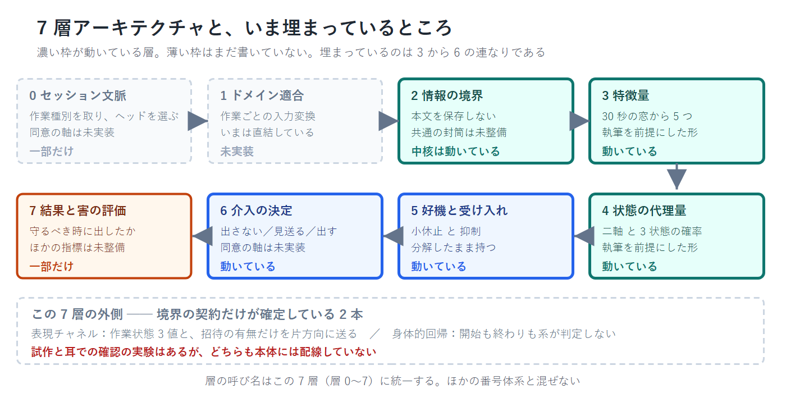
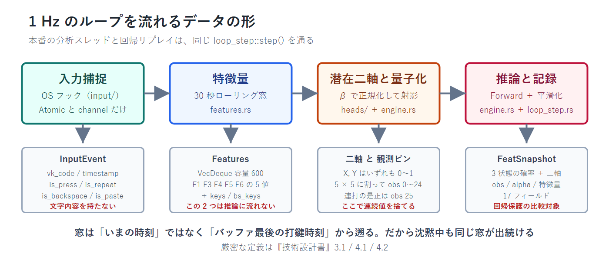
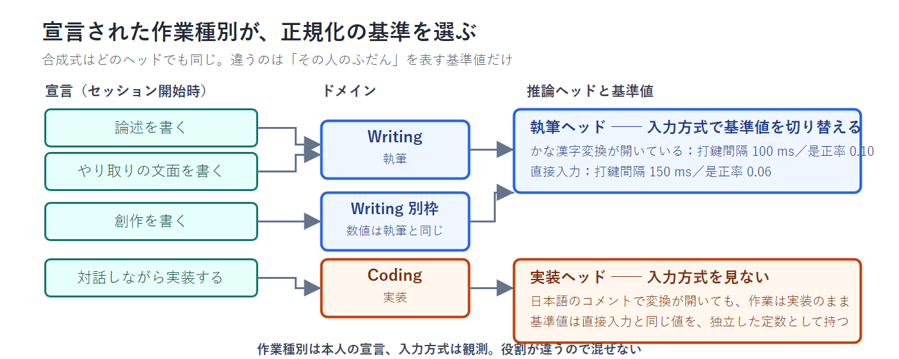
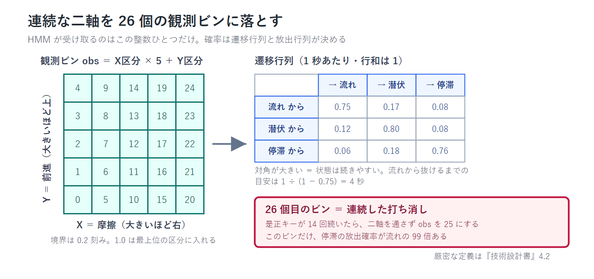
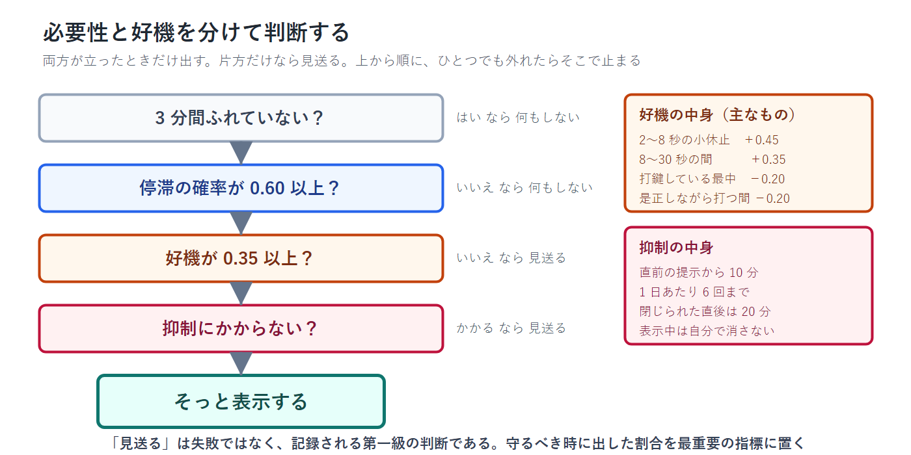
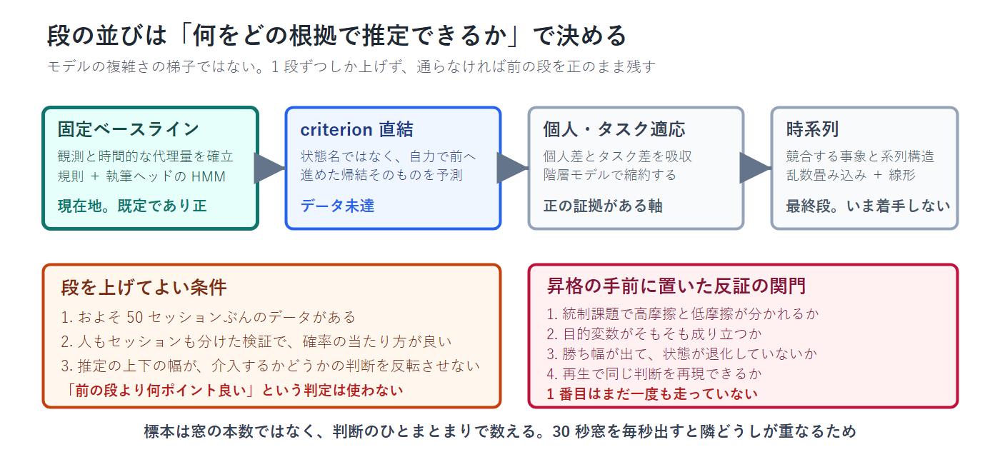
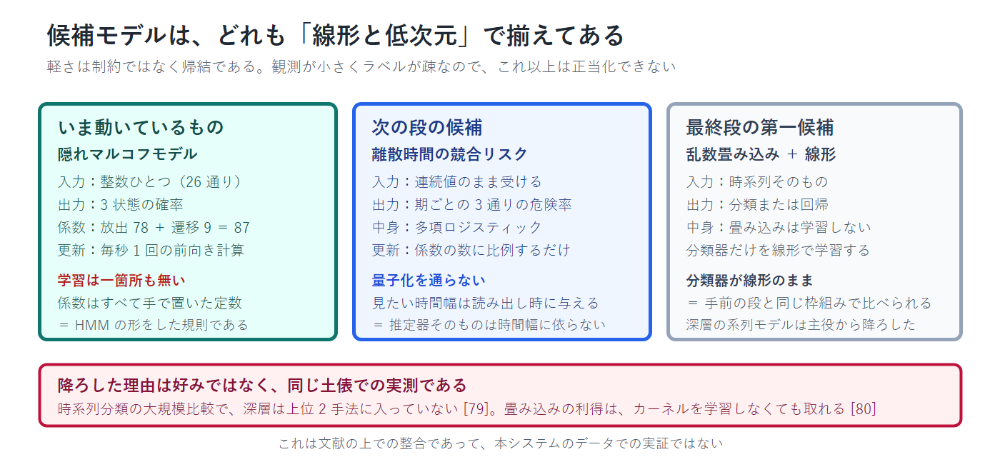

<!-- layout: title -->

# GSE — Generative Struggle Engine

**設計スライド**（提案プロジェクト補足資料）— 技術とアーキテクチャ

ZEN大学（2026年4月入学）　三浦 尊統

---

# 本書の位置づけ

- **読者**: 審査員（面接・説明）
- **役割**: アーキテクチャ・各層の計算・推論モデルの更新手段を、実物に即して示す
- **計算の厳密な定義と証明は『技術設計書』に置く**。本書はその地図である
- **本書は要約であり、新しい事実を持たない。計算の定義が食い違う場合は『技術設計書』を正とする**
- **参考文献**: [n] は『GSE参考文献』の通し番号を指す

---

# 全体像 — 7 層のうち、動いているのは 3 から 6 の連なりである

---

# 実装の骨格は、1 本の毎秒ループである

---

# ループの入口と出口

- **入口**: OS のフックが打鍵を捕まえ、**Atomic 操作とチャネル送信だけ**して即座に戻る
- ブロックする処理をコールバックに書けないため、重い判定は別スレッドへ逃がす
- **出口**: 毎秒 1 回、17 項目のスナップショットを作り、記録スレッドへ渡す
- **本番の分析スレッドと回帰リプレイは、同じ 1 つの関数を通る**。これが後述の回帰保護の前提
- 待ち時間は「次の 1 秒の目盛りまでの残り」に毎回入れ直す。**絶対時刻を基準にして誤差を溜めない**

---

# 層 2 — 何を取り、何を取らないか

内容を持たない観測だけで推定するのが、この設計の前提である

| 取るもの | 取らないもの |
| :---- | :---- |
| キーの種別（英数・記号・是正・空白などの区分） | **打たれた文字そのもの** |
| 押下と離上の時刻（ミリ秒） | 画面の内容・ウィンドウ名・アプリ名 |
| かな漢字変換が開いているかどうか | 変換の候補・確定した語 |
| 貼り付けの発生と、その文字数 | 貼り付けた内容 |
| 画面の切り替わりの時刻、ポインタの 1 秒ごとの粗い量 | 切り替わった先が何か、ポインタの軌跡 |

- 入力イベントの構造体に**文字を入れる場所がそもそも無い**。設計ではなく型で縛っている

---

# 層 3 — 30 秒の窓から 5 つの量を出す

| 記号 | 何を測るか |
| :---- | :---- |
| F1 | 打鍵の間隔の中央値。連続入力は除き、極端に長い間隔は外れ値として捨てる |
| F3 | 是正キーが全打鍵に占める割合 |
| F4 | 200 ミリ秒未満でつながった連なりの、平均の長さ |
| F5 | 2 秒以上あいた回数 |
| F6 | 是正のあとに 2 秒以上止まった割合 |

- 窓は**「いまの時刻」ではなく「最後の打鍵時刻」から遡る**。だから沈黙中も同じ窓が出続ける

---

# 層 3 — 「その人のふだん」を基準に 0〜1 へ畳む

- 生の値をそのまま使わず、**基準値との比**に直してから合成する
- 基準で 0、基準の 3 倍で 1 に飽和する。**それ以上は速さの差を見ない**
- **直接入力側**の基準値は、1 億 3600 万打鍵の大規模観測にある母集団の中央値に由来する [51]
- **かな漢字変換側は自前の実測較正値**である。**この 2 つは一つの尺度に畳めない**
- **打鍵数そのものは記録するが、推定には 1 ビットも流していない**
- 流していないことを、テストで契約として固定してある

---

# 層 3 → 4 — ヘッドを選ぶのは宣言、基準値を切り替えるのは観測

---

# 層 4 — 2 つの軸へ射影する

- **X（摩擦）** = 是正率 0.30 ＋ 是正後の停止 0.25 ＋ 打鍵間隔 0.25 ＋ 中断回数 0.20
- **Y（前進）** = 連なりの長さ 0.40 ＋（速さ）0.35 ＋（途切れなさ）0.25
- 重みの合計はどちらも 1.0。**合成式はどのヘッドでも同じで、違うのは基準値だけ**である
- こうしておくと、あとで結果が変わったとき「式を変えたのか基準値を変えたのか」を分離できる
- 沈黙が続く間は、直前の文脈から**摩擦の下限を時間に比例して押し上げる**

---

# 層 4 — HMM が受け取るのは、整数ひとつだけである

---

# 層 4 — 前向き計算と、出力の平滑化

- 状態は **流れ / 潜伏 / 停滞** の 3 つ。毎秒、遷移と放出をかけて正規化する
- 手法そのものは古典的な前向き計算であり、目新しいものではない [52]
- 出た確率をそのまま使わず、もう一段だけ指数平滑をかける。**平滑後の値を記録にも介入判定にも使う**
- 平滑の強さは通常 0.40、打ち消しが続いたときだけ 0.60 に上げて追随を速める
- 滞留時間の分布を持たずに**約 4 秒の慣性**を作るための層である
- **HMM の係数 87 個（放出 78 ＋ 遷移 9）はすべて手で置いた定数**である。学習は一箇所も入っていない

---

# 沈黙は 1 つではない — 3 つの経路に割る

| 経路 | いつ | どう扱うか |
| :---- | :---- | :---- |
| 打鍵中 | 打鍵間隔が採れ、直前 2 秒以内に打鍵がある | そのまま毎秒更新する |
| 移行中 | 打鍵間隔は採れるが 2 秒以上あいた | 8 秒を超えたら摩擦の下限を時間で押し上げる |
| 沈黙中 | **窓から打鍵間隔が 1 つも採れない** | 直前の文脈から観測を合成して更新する |

- 10 秒を超える沈黙のあとは、**3 打鍵続いて初めて「戻ってきた」とみなす**
- 2 秒未満で打鍵間隔が採れないときは、何も出さない。**ポーズと認めない**
- 分岐は打鍵の有無ではない。**打鍵があっても間隔が 1 つも採れなければ沈黙の経路に入る**

---

# 層 5・6 — 両方が立ったときだけ出す

---

# 「見送る」を第一級の判断として記録する

- 必要性が立っても好機が立たなければ**出さずに見送り、その事実を残す**
- 割り込んでよい瞬間を待つ設計であって、閾値を下げれば当たるという話ではない
- 抑制の判定は、**表示中の提示を自分で消さない**ように順序を組んである
- 見送りで止めた提示が上限や間隔を消費しないよう、**記録より前に判定を置く**
- 大量に出さないための上限（1 日 6 回・間隔 10 分）は、効果ではなく**負担の設計**である

---

# 層 7 — 何を「害」と数えるか

| 指標 | 定義 |
| :---- | :---- |
| **有害介入率** | 守るべき状態に出してしまった割合。**最重要の安全性指標** |
| 適合率 | 停滞に出せた割合。上の指標と足すと 1 になる |
| 再現率 | 停滞のうち出せた割合 |
| 負担 | 単位時間あたりの提示回数 |

- **精度ではなく「守るべき時に出してしまわなかったか」を先に見る**
- 提示の理由ごとに分解して出す。どの理由が害を出しているかを切り分けるため

---

# 層と層をつなぐのは、型と契約である

| 境界 | 渡すもの |
| :---- | :---- |
| 入力 → 分析 | 内容を持たない入力イベント。容量つきチャネルで送る |
| 特徴量 → ヘッド | 5 つの量と、変換が開いているかどうか |
| ヘッド → 推論 | 0〜1 の二軸ふたつだけ |
| 推論 → 決定 | 停滞の確率・是正率・連なりの長さ・是正後の停止率・無操作時間 |
| 決定 → 画面 | 3 値の行動と、理由と、抑制の一覧 |

- **分析側から OS の関数を呼ばない**。この一線があるので同じテストが両方の OS で走る
- 作業種別からヘッドを選ぶ変換は**1 か所にしか置かない**。2 か所に書くと本番と再生でずれる

---

# 推論を変えたことを、どう検出するか

- ゴールデンの記録を再生し、**スナップショット列がバイト単位で一致すること**を検査する
- 再生の CLI 1 本が、単体・統合・回帰・評価・調整の 5 役を兼ねる。記録の形式定義は型から機械生成する
- 推論を変えるときは、係数ではなく**まず版番号を上げる**。次にゴールデンを作り直す
- **差分が意図どおりかを作業記録に残し、無関係な差分が出たら変更のほうを見直す**
- 「取り出すだけの変更」と「つなぎ替える変更」は別のコミットに割る
- 前者は既存のゴールデンが 1 バイトも動かないこと、後者は**新しい 1 本が意図した差分を担う**こと

---

# 推論モデルの段 — 1 段ずつしか上げない

---

# 複雑さの梯子をやめた理由は、実測の記録である

| 何が起きたか | 規模 |
| :---- | :---- |
| 入力特徴を足したら**帰無モデルより性能が下がった** [72] | 179 名を 14 日間・のべ 10,760 事例 |
| マウス軌跡を画像にした畳み込み回帰の決定係数が**負の大きな値**になった [73] | 994 名 |
| 機械学習と回帰の差が、バイアスの低い比較では**ちょうど 0.00** だった [75] | 71 研究 282 比較 |
| 多モーダルが単一モーダルに**明確な優位を示さなかった** [76] | 42 研究 |

- **データが無いのに段を上げることは、この分野で最も再現性を壊す行為である**

---

# 評価法の差は、アルゴリズムの差より大きい

| 何を変えるか | 動く幅 |
| :---- | :---- |
| アルゴリズム | 最大 12 ポイント（実用域どうしは 3 ポイント） |
| モダリティ | 18 ポイント |
| **評価法（交差検証 → 人を分けた検証）** | **31 ポイント** |

- 同じデータで、人を分けた途端に多数決の基準を下回った [74]
- **投資すべきは複雑化ではなく、被験者を跨いだ評価の正直さと個人化である**
- 個人化には一貫して正の証拠がある。集約は平均 71% でも人によるばらつきが大きい [81]

---

# 昇格の判定量そのものを作り直した

- 旧案は「前の段より何ポイント良いか」だった。**これは原理的に測れない**
- 100 標本での誤差幅はおよそ ±10 ポイントあり、折り返し間の標準誤差はそれを大きく過小評価する [77]
- 手元の較正は数名規模である。**「＋3%」は、その道具では読めない数字である**
- 置き換えた判定量は 2 つ
  - **人もセッションも分けた検証で、確率の当たり方が良いこと**
  - **推定の上下の幅が、介入するかどうかの判断を反転させないこと**
- **データ量の条件（およそ 50 セッション）は残す**。外したのは判定量のほうである
- 手前には軸そのものを疑う関門を置いてある。**それはまだ一度も走っていない**。現在の最大の未決である

---

# 標本は「窓の本数」では数えない

- 30 秒の窓を毎秒出すので、**隣り合う窓は 30 分の 29 が重なっている**
- 重なりを無視した交差検証は成績を持ち上げ、除くと**有意に落ちる** [78]
- したがって数える単位は窓ではなく、**判断のひとまとまり**とする
- 実地の参照点では、7 週間で 1 人あたり平均 26 回ほどの記録しか集まらない
- **「1 人あたり数十セッション」は数か月を要する**。ここを短く見積もらない

---

# 候補モデル — 軽さは制約ではなく帰結である

---

# 次の段は「状態の名前」ではなく「帰結」を予測する

- 主観の申告を待たずに教師信号が立つように、**観測できる行動そのものを目的変数にする**
- 二値ではなく**離散時間の到達時間**として定式化する。「何分以内か」を後から選べるようにするため
- 目的の事象を排除してしまう事象（外部化・離席）は、**打ち切りではなく競合する事象**として扱う
- 離席は競合と真の打ち切りの混ざりものなので、**潰さずに両端で上下の幅を取る**
- 上下の幅を作るために推定器を 2 本学習しない。**1 本で学習し、読み出しの段階で扱いを変える**

---

# 個人化は「抑える方向」にだけ使う

- 個人差は平均の水準ではなく、**どの信号がその人で効くかという写像のほうに出る**
- 実測でも、ある被験者だけ関係の向きが反転していた。**基準値ではなく係数を個人化する**
- 個人化して良いのは**いつ出さないか（間合いと抑制）と、強さの上限**だけである
- **文面や見せ方を個人ごとに最適化して説得力を上げる方向は採らない**
- いま実装されている「凍結」は、**評価設計上の前向き固定と、解析側の分割**である
- **実行中に個人の基準値を学習して固定する機構は、まだ書いていない**

---

# 較正の前と後で、介入してよい範囲を変える（未実装）

| 較正の状態 | 推定 | 介入 | 妥当性の主張 |
| :---- | :---- | :---- | :---- |
| **較正前** | **動く**（固定ベースラインはゼロデータで走る） | **強い介入を出さない** | **しない** |
| **較正後** | 動く | 必要性と好機に従って発火 | **関門を通った範囲でのみ** |

- 原則は「**較正が済んでいないヘッドでは強い介入を出さない**」
- 不確実なときに自動化を弱めるのは既知の原理であり、本提案の発明ではない
- **これは設計であって現行の挙動ではない**。較正の状態を見て出し分ける分岐は**まだ書いていない**
- **現行に強い介入そのものが無い**。出せるのは表示・見送り・何もしないの 3 つだけである

---

# 主張の層構造 — 4 つの計算を分ける

| 層 | 何を計算するか | 何で検証するか | 確証 / 探索 |
| :---- | :---- | :---- | :---- |
| **L0: 潜在二軸** | 5 つの量 → 摩擦 / 前進 | 主観プローブとの**個人内の順序一致** | **確証** |
| L1: 停滞 | 二軸 → 停滞の確率 | 独立な主観申告、行動アウトカム | 探索 |
| L2: 必要性 | 閾値と抑制による**介入要否の決定** | 混同行列・有害介入率・適合率 | 探索 |
| L2': 好機 | 小休止や間合いの**タイミング判定** | 近接アウトカム | 探索 |

- この 4 つは**主張の層**であり、前半の処理の 7 層（層 0〜7）とは別の軸である

---

# 確証するのは L0 だけである

- 停滞の確率は「介入判断が焚く」値ではなく「**推論層が計算する**」値である
- 介入の判断はそれを閾値で消費する**別の計算**であり、性能は独立に評価する
- L0 で確かめられるのは「**内部の軸を、同種の自己申告と照合する収束的な妥当性**」である
- それは停滞や必要性の**独立で客観的な正解ではない**
- したがって「**認知状態を捉えた**」とは書かない

---

# 何が実装され、何が未実装か

| 対象 | 現況 |
| :---- | :---- |
| 推論パイプライン（層 3〜4） | 実装済み。ゴールデンのバイト一致で守っている |
| 介入の決定（層 5〜6） | 実装済み（同意の軸を除く）。ただし**再生は近似**でバイト一致の対象外 |
| 較正に応じた介入のゲート | **未実装**。設計だけが確定している |
| 記録形式の定義 | 実装済み。型から機械生成し差分を検出 |
| 表現チャネル | **本体には配線していない**。境界の契約と最小要件だけが確定している |
| 身体的回帰 | **未実装**。設計だけが確定している |
| 別プロセスの入力欄の検出 | **片方の OS だけ計器がある。抑止の配線はどちらにも無い** |
| 推論の外部ランタイム化 | **未実装**。段を上げる判定を通った場合にのみ検討する経路 |

---

# 身体的回帰は、系が判定しない設計にした

- 画面から離れることへの**方向づけ**であって、系はその開始も終わりも判定しない
- 時間の長さや往復の回数に、系の側の閾値を**置かない**
- 残り時間の表示やカウントダウンも**実装しない**。閾値を持たないと表示できないためである
- 歩数・距離・速度・位置情報は、本体の判定・表現・主評価から**恒久的に外した**
- 代償は隠さない。**不便が実際に担われたかを、系が確かめる手段は無くなる**

---

# 先行研究との関係 — 新規性の所在

- **打鍵と隠れマルコフモデルで執筆過程を推定すること自体は、本提案の新規性ではない** [83]
- 先行は 30 秒窓・10 秒刻みの移動窓で、72 名・18 万打鍵から 9 状態を推定している
- ただしその先行は**かな漢字変換を一語も扱っていない**。結果のテキストを見ることで迂回している
- 打鍵から認知機能へ届くこと自体は複数の一次証拠がある [11][13]
- 実配備の実績という一点では、既存の実装に完全に負けている [14]

---

# 到達点の目安を、先に書いておく

| 標的 | 設計 | 数値 |
| :---- | :---- | :---- |
| 作業条件の分類 | 交差検証 | 90.0% [74] |
| 同上 | **人を分けた検証** | **58.9%**（多数決の基準 61.8% を下回る）[74] |
| 自己申告の生産性 | 実地・個人ごと・4 社 20 名 | 適合率 0.57 / 再現率 0.48。中央値分割なので**偶然 +0.07** [15] |

- 打鍵だけの個人化で 71% 前後、**人を跨ぐ集約は同じ 71% でもばらつきが大きい** [81]
- 生体センサによる中断可能性予測の再現研究は失敗している。逐語「**多数派分類器の基線を有意に上回るモデルを再現できなかった**」[46]
- **流れ・潜伏・停滞そのものを内容なしの打鍵から推定した研究は、見つからなかった**

---

# まとめ

- **動いているのは層 3 から 6**。毎秒 1 本のループが、内容を持たない打鍵から 3 状態の確率まで通す
- **HMM の係数 87 個はすべて手置き**である。学習は入っていない。だから比較の基準として使える
- **必要性と好機を分け、見送りを記録する**。守るべき時に出した割合を最重要の指標に置く
- **段の並びは複雑さではなく、何をどの根拠で推定できるかで決める**。判定量は当たり方と上下の幅
- 通らなければ**固定ベースラインを正のまま残す**。軸そのものを疑う関門を手前に置いてある
- **確証するのは潜在二軸だけ**である。それ以外は探索として報告する
- 計算の厳密な定義と証明は『技術設計書』に置いた
