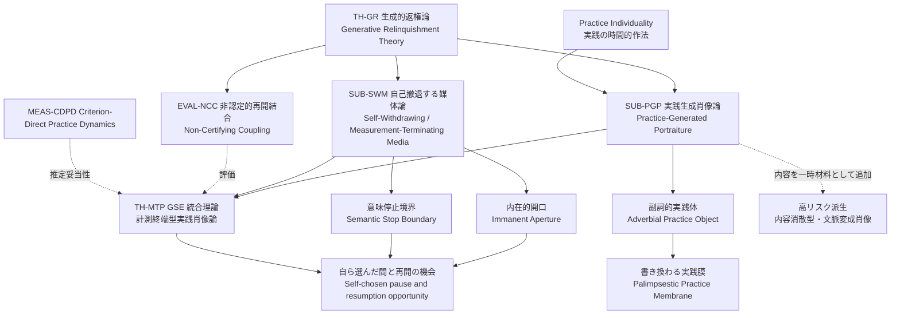

# GSE 理論体系・実現可能性・構築ロードマップ

> ⚠️★★★ **2026-09-19 に `.idea/` から移した（段 3 判断 1 #4）。** 元のファイルは `.idea/20260915-gse-theory-architecture-and-roadmap.md`（2026-09-15）。移した理由は、改訂を版管理し `/cross-review` を通すためである。作業記録は `.steering/20260919-ssot-h-theory-docs/`。
> - ★ **位置づけ**: **theory candidate**（証拠階梯 `EH0` = 概念監査まで）。⚠️ **SSOT の主張ではない**。`docs/research-positioning.md` §1 は理論を**問い**として参照するだけで、確証核は L0 のまま、headline も変えない（理論レビュー 判断 1 #1 = J-1）。
> - ⚠️ 理論名「生成的返権論」は**作業名**である（生成芸術論側のサーヴェイ S3 の後に確定・段 3 判断 1 #3）。語「返権」は確定（`docs/glossary.md`）。
> - ★ **本文へ反映したのは、研究者が裁定した事項と、昇格時に一括で直す機械的な規則だけ**である（→ 下の「2026-09-19 の改訂」）。
> - ⚠️★★★ **批判的レビューの判定（保持・統合・縮小・棄却・要サーヴェイ）は提案であり、研究者の採否は未了である。本文には当てていない。** 読むときは併読すること: `.steering/20260918-theory-critical-review/review-A.md`・`ssot-collision-findings.md`・`citations-audit.md`（★ 著者・年で引いた文献の多くは `docs/references.md` に未登録）。
>
> **2026-09-19 の改訂（★ 本文に当てたもの）**
> - 「非支配的協調」→ **「関係的自律を支える協調」**（段 3 判断 1 #1・S2）
> - 草案の「計測なき身体回帰」（非認定によって主体の側に残る可能性）→ **「自ら選んだ間と再開の機会」へ統合**（段 3 判断 1 #2・J-14）。⚠️ SSOT の「計測なき身体回帰」は ADR-017 D8 の (B) 結合側を指す別の用法で、本書はそれを使わない
> - 「Lv1 Nudge」→「Nudge」（理論レビュー 判断 1 の機械的な規則・ADR-018 D7）
> - リンクを `docs/theory/` からの相対パスへ直した（★ `.idea/` に残る草案へのリンクは追跡外のファイルを指す）
> - ★ 裁定事項の注記を本文の該当箇所に足した: BRIDGE-DN の統合（J-6）・GR-H11 の保留（J-7）・非再捕捉の射程（J-4 = ADR-033）・論文計画の記号の改名規則

> Status: idea / synthesis memo / pre-SSOT draft
>
> この文書は、GSE から提唱しうる理論群を、提出資料へ転用できる粒度で整理するための統合メモである。ADR、SSOT、実装仕様、新規性の証明ではない。既存の理論メモを置換せず、関係・成立条件・構築順序を示す索引として扱う。Claude Code との批判的検討と、人間による採否判断を経るまで、ここでの分類・名称・命題を SSOT として引用しない。

---

## 0. 結論

GSE から理論を構築する実現可能性はある。ただし、現時点の成立度は四つに分けて判断する必要がある。

| 成立水準 | 現時点の判定 | 意味 |
|---|---|---|
| 概念的成立 | 高い | 各概念の役割と相互関係を矛盾なく記述できる |
| 技術的実現 | 中程度 | 現行アーキテクチャに接続できるが、Portrait / Expression / Semantic Stop は未実装 |
| 経験的成立 | 未確定 | リプレイ試作、形成的試視、対照実験が必要 |
| 新規性の成立 | 未確定 | 迅速な survey では残余差分があるが、体系的レビューが必要 |

提出時には、多数の独立理論を同時に主張しない。次の構成を主案とする。

1. **上位一般理論**: 生成的返権論
2. **GSE 固有の統合理論**: 計測終端型実践肖像論
3. **下位理論モジュール**: 実践生成肖像論／自己撤退する媒体論
4. **評価・測定モデル**: 非認定的再開結合／Criterion-Direct Practice Dynamics

このうち、提出資料で「本研究が提唱する理論」として前面に出す候補は 1 と 2 に絞る。3 は理論的支柱、4 は理論を判定する方法と別論文化候補として配置する。T1-T5 という旧番号は参照互換のため当面括弧内に残すが、同格の五理論を意味しない。本メモ内の暫定コードは上位理論 `TH-GR`、統合理論 `TH-MTP`、下位理論 `SUB-PGP/SUB-SWM`、評価モデル `EVAL-NCC`、測定モデル `MEAS-CDPD` とする。番号だけのコードは ML 段階、証拠段階、論文番号と衝突するため用いない。

---

## 1. 理論関係図



テキストで表すと次のようになる。

```text
                    [生成的返権論]
                           |
          +----------------+----------------+
          |                                 |
 [実践生成肖像論]                  [自己撤退する媒体論]
          |                                 |
 Practice Individuality             内在的開口
          |                                 |
   副詞的実践体                    Semantic Stop Boundary
          |                                 |
 書き換わる実践膜                           |
          +---------------+-----------------+
                          |
              [計測終端型実践肖像論]
                          |
                 自ら選んだ間と再開の機会
                          |
          +---------------+----------------+
          |                                |
 非認定的再開結合による評価       Criterion-Direct な推定検証
```

### 1.1 主張階層と語の役割

理論名、構成概念、命題、実証予測を同じ段に置かない。以後は次の七種類を区別する。

| 種類 | 役割 | GSE の該当項目 | 単独で「提唱理論」と呼ぶか |
|---|---|---|---|
| 上位理論 | 複数領域にまたがる説明枠組み | 生成的返権論 | 呼ぶ。ただし現段階は theory candidate |
| 統合理論 | GSE における複数の下位理論と機構の結合 | 計測終端型実践肖像論 | 呼ぶ。ただし GSE 固有 |
| 下位理論モジュール | 統合理論の一側面を説明する | 実践生成肖像論、自己撤退する媒体論 | 原則として前面に出さない |
| 評価・測定モデル | 理論を検査する観測・分析の枠組み | 非認定的再開結合、Criterion-Direct Practice Dynamics | 呼ばない。独立論文化時に再判定 |
| 構成概念・機構 | 理論を構成し、実装や観測へ写像する語 | Epistemic Relinquishment、Practice Individuality、Immanent Aperture、Semantic Stop Boundary | 呼ばない |
| 作品・造形形式 | 構成概念を具体化する実作候補 | 副詞的実践体、書き換わる実践膜 | 呼ばない |
| 命題・予測 | 理論から導かれ、反例または観測で負けうる主張 | 横断中核命題、構成命題、実証予測 | 理論名に昇格させない |

「自ら選んだ間と再開の機会」は独立理論ではなく身体論的テーゼ兼到達点、「関係的自律を支える協調」は規範的成功条件をまとめる作業語、「返権の負荷逆説」は失敗様式を記述する分析語とする。内容消散型・文脈変成肖像は高リスクな派生作品案であり、理論階層には加えない。権限台帳と負担台帳を併記する枠組みの正規名は**権限・負担の二重台帳**とし、「二重トポロジー」は理論的な図式を指す場合だけに限定する。

### 1.2 命題の四系列

| 系列 | 番号 | 役割 | 現在の内容 |
|---|---|---|---|
| 横断中核命題 | `CORE-CS` / `CORE-ART` / `CORE-NORM` | 応募・論文で各領域へ提示する一文の主張 | CS、芸術、規範の三命題 |
| 接続命題 | `BRIDGE-DN` | 外部理論との関係と差分を限定する | Digital Nature との接続 |
| 構成命題 | `GR-C1`-`GR-C7` | 生成的返権論の内部構造を定義する | 旧 命題 A-G |
| 実証予測 | `GR-H1`-`GR-H12` | 条件比較と測定で支持・反証する | 旧 P1-P12 |

`P` は論文計画の P0-P4 と衝突するため、実証予測を `GR-H1`-`GR-H12` へ移した。参照互換のため旧番号を括弧で併記する。研究ゲート `RG-*`、測定量、必要条件は命題番号に含めない。

> ★ **2026-09-19 注記（理論レビュー 判断 1 の機械的な規則）**: 論文計画の記号も `P0`〜`P4` をやめ **`Paper-A` 型**へ改める（★ `[Pn]`（中央書誌）・`P1`（解析段）・被験者 ID `P010` との衝突を避けるため）。同じ規則で、研究計画の `E0`〜`E4`・`O0`〜`O3` は実体名で呼ぶ。

### 1.3 二理論と各命題の対応

| 主張 | 直接の理論的親 | 下位理論・機構 | 主な判定手段 |
|---|---|---|---|
| `CORE-CS` 停止可能な適応系 | 生成的返権論 | 自己撤退する媒体、Semantic Stop Boundary、権限・負担の二重台帳 | 実装監査、停止後ログ、非再捕捉テスト |
| `CORE-ART` 終端を作品形式にする | 計測終端型実践肖像論 | 実践生成肖像、自己撤退する媒体、内在的開口 | replay 作品比較、形成的試視 |
| `CORE-NORM` 権限返還と負担解除 | 生成的返権論 | 限定性、異議可能性、見逃し可能性、非放棄性、非再捕捉性、品質下限 | 負担・判断品質の二軸評価 |
| `BRIDGE-DN` 計算機自然内部の局所的な非認定 | 生成的返権論 | 自己撤退する媒体、計測終端、Semantic Stop Boundary | 概念比較と処理境界の監査 |

`BRIDGE-DN` は第四の主理論でも、「計算機自然の外部」を立てる存在論でもない。計算と物理の循環が続く環境内で、個別システムの推論・達成認定・応答要求をどこで失効させるか、という境界主張に限定する。

> ★ **2026-09-19 注記（理論レビュー 判断 1 #16 = J-6）**: BRIDGE-DN は**独立の接続命題にしない**。CORE-CS の**比較節**として残す（★ Digital Nature は環境全体の世界観、CORE-CS は個別システムの停止の設計 —— 粒度が違う。`docs/literature/20260919-digital-nature-primary-scope.md`・RP §3）。⚠️ 上下の表の `BRIDGE-DN` 行は、この統合の前の形である。

四つの一文主張は次を暫定正本とする。

- **`CORE-CS`**: 適応システムでは、いつ主導権を取るかだけでなく、いつ推論、意味認定、達成認定、応答要求を終えるかを、監査可能で非再捕捉的なシステム境界として設計しなければならない。
  > ★ **2026-09-19 注記（理論レビュー 判断 1 #3 = J-4・#2 = J-3・ADR-033）**: 「非再捕捉的」の射程は「応答を**成功**として学習・評価・報酬へ戻さない」までであり、★ **拒否を尊重して控える利用（`RECENT_DISMISS_MS` など）は許す**（ADR-033 D2）。★ 停止の対象は現行 GSE に実在する処理から取る（J-3）。
- **`CORE-ART`**: 実践経路から表現を形成した生成作品が、画面外行為の意味づけと達成認定を意図的に終えることは、故障や未完成ではなく作品の終端形式になりうる。
- **`CORE-NORM`**: 適応システムによる権限の返還は、解釈、検証、修正、応答、是正、帰結の負担を利用者へ一方的に移さず、判断品質を許容範囲内に保つ場合にのみ規範的成功候補となる。
- **`BRIDGE-DN`**: 計算と物理が循環する計算機自然の内部でも、個別システムの意味推論、達成認定、応答要求には、局所的かつ監査可能な終端を設計できる。

| 上位主張 | 主に依存する構成命題 | 主に依存する実証予測 |
|---|---|---|
| `CORE-CS` | `GR-C1` 双方向の委譲、`GR-C2` 設計された非知、`GR-C4` 終端形式、`GR-C7` 権限と負担の分離 | `GR-H3`、`GR-H5`、`GR-H7`-`GR-H9`、`GR-H11` |
| `CORE-ART` | `GR-C2` 設計された非知、`GR-C3` 権限軌跡、`GR-C4` 終端形式、`GR-C5` 画面外身体 | `GR-H1`-`GR-H6`、`GR-H10` |
| `CORE-NORM` | `GR-C1` 双方向の委譲、`GR-C4` 終端形式、`GR-C6` 善性の非自動性、`GR-C7` 権限と負担の分離 | `GR-H2`-`GR-H5`、`GR-H8`-`GR-H12` |
| `BRIDGE-DN` | `GR-C2` 設計された非知、`GR-C4` 終端形式、`GR-C5` 画面外身体 | `GR-H3`、`GR-H7`、`GR-H8` |

**評価契約 v0.1**: [命題カバレッジ行列](../../.steering/20260916-gse-theory-operationalization-review/core-proposition-coverage-matrix.md) で全 `GR-H1-H12` の primary owner を一つに定め、[CORE-CS](../../.steering/20260916-gse-theory-operationalization-review/core-cs-evaluation-contract.md) は実装監査と知覚を、[CORE-ART](../../.steering/20260916-gse-theory-operationalization-review/core-art-evaluation-contract.md) は作品成立・経路依存・非診断性・終端形式・負担を、[BRIDGE-DN](../../.steering/20260916-gse-theory-operationalization-review/bridge-dn-evaluation-contract.md) は狭い概念比較と境界監査を分離して判定する。これらは pre-SSOT / `EH0` の契約草案であり、実装・計器・外部評価の成立を意味しない。

---

## 2. 提唱候補となる理論の暫定整理

### TH-GR. 生成的返権論（旧 T1）

**種類**: 上位一般理論／生成システム論

**中心命題**:

> 生成システムの形式は、何を生成したかだけでなく、観測・推論・誘導・認定の権限をどのように行使し、どこで主体側へ残すかという権限軌跡を含む。

**中心規範命題（作業形）**:

> 生成的返権は、望ましい状態を決め続ける父権的介入と、判断・検証・帰結負担を利用者へ押し戻す放置的返還の双方を避ける。限定的な転帰予測、異議可能で見逃し可能な招待、意味認定と応答義務の終端を組み合わせ、罪悪感や不当な負担集中を生まない関係的自律を支える協調を目指す。

`関係的自律を支える協調` は、新しい理論番号や確立済みの政治哲学的接続ではなく、TH-GR の規範的成功条件を表す作業語とする。共和主義的 non-domination との接続は、追加サーヴェイ後に採否を判断する。

> ★ **2026-09-19 注記（段 3 判断 1 #1・理論レビュー 判断 2 #3・S2 `docs/literature/20260919-non-domination-and-autonomy-norms.md`）**: 旧名「非支配的協調」を改めた。
> - ⚠️ 共和主義の非支配は介入の**能力**を問い、**放置を問わない**（[P380][P381]）。→ 旧名は「放置的返還を避ける」という中身と合わず、誤読を招いた。
> - ★ **依拠**: 自律 ≠ 独立（関係的自律 [P382]）／統制された介入の条件 = 継続的な統制・事後の透明性・choices over choices（[P380]）／罰を付けない選択肢。
> - ⚠️ 「父権でも放置でもない」三項の構図そのものは既出（SDT の circumplex [P390]・医療倫理 [P391]・abstract のみ）→ **借りた**と書く。
> - ★ **差分の候補**: 見逃し可能性（応答しないことを選択として読まない）・非再捕捉（ADR-033）・意味認定と応答要求の終了（⚠️ いずれも今回の範囲（S2・2026-09-19）で見つからなかっただけ）。
> - ⚠️ 招待を出す時期と有無を系が決め、本人が統制できない限り、GSE の招待を「非支配的」とは言えない（[P380] の基準）。

**包む対象**:

- 実践生成肖像論
- 自己撤退する媒体論
- Semantic Stop Boundary
- 非認定的再開結合
- 自ら選んだ間と再開の機会という身体論的到達点

**独立性**:

GSE を越えて、生成芸術、bioadaptive media、AI 創作支援、personal informatics、教育・推薦・介入系へ一般化しうる。

**最大の弱点**:

- 「返権」が法的な権利移転や全面的権力放棄に見える
- 既存の open work、reflective design、ambiguity、non-use、data refusal の言い換えになりうる
- 「最初から推論しないこと」と「作動中の推論を停止すること」が混ざりやすい
- 権限を返したように見せながら、解釈・検証・修正・説明要求・帰結負担だけを利用者へ集中させる「負担転嫁」になりうる

**防御線**:

- `返権` は設計者・運用者が負う領域限定的な自己制限を表す規範的比喩と定義する
- 形式生成の自律性、解釈の開放性、推論処理の継続性を独立軸にする
- 狭い研究概念には `Epistemic Relinquishment`、実装には `Semantic Stop Boundary` を用いる
- O/I/F/V/C/R の権限台帳と、解釈／検証／修正／応答／説明要求／是正義務／帰結負担の負担台帳を分離する
- 返還後の意味形成は任意であり、次の処理、報酬、利用継続の条件ではないことを必要条件候補にする

### SUB-PGP. 実践生成肖像論（旧 T2）

**種類**: 肖像論／生成表現論

**中心命題**:

> 肖像は顔、属性、能力、現在状態を表すものに限られない。人が生成し、ためらい、修正し、停止し、再開した時間的な作法を、セッション固有の経路依存的形式として現すことができる。

**主要構成概念**:

- Practice Individuality
- 指標性と非代替性
- 経路依存性
- 非診断性
- 暗黙の共同作者性
- 実践・推論造形系・媒体による三者の作者性
- 副詞的実践体

**独立性**:

身体回帰や介入を含めなくても成立しうる。Writing、Coding、学習、音楽練習、制作などへ横展開可能である。

**最大の弱点**:

- 抽象データ可視化や data portrait との差が消えやすい
- 「本人らしさ」が個人識別や人格推定へ滑りやすい
- 三状態の色違い表示を肖像と呼ぶだけになる危険がある

**防御線**:

- 同じ最終値でも異なる経路から異なる形が生じることを要求する
- 人格・能力・健康ではなく、セッション内の実践関係だけを対象にする
- 本人性、診断的読解、outsider linkability を別々に評価する

### SUB-SWM. 自己撤退する媒体論（旧 T3）

**種類**: 媒体論／注意・介入の美学

**中心命題**:

> 身体へ働きかける媒体の完成は、表示・追跡・フィードバックを増やすことではなく、適切な時点で自らの媒介、注意要求、意味認定を終え、主体と環境のために場所を空けることにありうる。

**主要構成概念**:

- Immanent Aperture
- Semantic Stop Boundary
- self-withdrawal
- 非認定
- 非回収
- 見逃し可能な招待
- センシングされない外部
- 応答義務の終了

**独立性**:

肖像を使わないアンビエントメディア、AI アシスタント、ウェルビーイング技術、教育・介入 UI にも適用しうる。

**最大の弱点**:

- 単なる画面消去、dismiss、timeout、故障と区別しにくい
- calm technology、slow technology、non-use、undesign との重なりが大きい
- 弱くすると届かず、強くすると通知・命令へ戻る
- 自己撤退が支援ではなく、説明・検証・責任を利用者へ残す放置として経験されうる

**防御線**:

- 何を停止し、何が継続するかを処理単位で宣言する
- 実装上の停止と、停止を知覚させる表現を別々に検証する
- 故障・期限切れ・招待解除・意味停止を同一視しない
- 意味停止と応答義務の終了を別々に操作し、負担転嫁条件を対照に置く

### EVAL-NCC. 非認定的再開結合（旧 T4）

**種類**: HCI 評価モデル／介入方法論

**中心命題**:

> システムは、利用者が招待に従った、身体へ戻った、回復したと認定せずとも、招待の受容、保留、拒否、無応答と、その後の実践動態および主観的負担との結合を、非評価的な研究アウトカムとして検証できる。非認定的結合が規範的な成功候補となるのは、意味が確定していない開口を避け、見逃し、または応答しないことが、罪悪感、応答義務、不利益予期、再捕捉を生まず、支援到達可能性と判断品質を損なわない場合である。

**主要構成概念**:

- self-chosen pause and resumption opportunity
- post-resumption stability
- receipt-free resumption
- no-response branch（保留、拒否、見逃し、無応答）
- perceived obligation / guilt / anticipated penalty
- choice symmetry（いずれの分岐も自動的な正誤・達成認定へ結びつかないこと）
- coupling as primary outcome
  > ⚠️ **2026-09-19（理論レビュー 判断 1 #7 = J-13）**: この名を**流用しない**。★ ADR-023 の主要アウトカム（「出口への結合」・HIR と機会保存の行動指標）とは中身が違う（負担・品質・依存の gate を持つ）。
- 予測入力と報告アウトカムの分離

**独立性**:

アート理論というより、完了確認を持たない介入をどのように評価するかという HCI 方法論として独立しうる。

**最大の弱点**:

- 再開は回復を意味しない
- 同じ打鍵由来の入力とアウトカムで循環しうる
- invitation に従ったかを観測できない
- 再開指標だけでは、介入後に残った検証負担や放置不安を捉えられない
- dismiss や無応答が実装上可能でも、利用者が期待への違反、失敗、将来の不利益として経験する可能性がある
- 罪悪感の低さだけでは、支援を放棄された状態と関係的自律を支える協調を弁別できない

**防御線**:

- 回復、身体行為、介入遵守をアウトカム名に使わない
- 後続指標を介入判断へ戻さず、評価専用に固定する
- 速度、正確さ、再停止、外部化、離脱を競合転帰として分離する
- タスク固有の interaction burden、verification burden、accountability displacement、consequence-burden concentration を独立アウトカムにする
- 受容、保留、拒否、無応答を事前定義した分岐として扱い、無応答を欠測や不遵守として自動的に除外しない
- 罪悪感、義務感、不利益予期、監視感を測り、無介入条件、命令条件、応答確認を要求する条件と比較する
- 主観的負担が低くても、支援到達可能性、主タスク継続、判断品質、誤受容、無検証依存が許容幅を外れた場合は放置的返還として棄却する

**生成的返権論との接続**:

EVAL-NCC は新しい規範理論ではなく、`CORE-NORM` と `GR-C7` を評価へ写すモデルである。関係的自律を支える協調は成功判定基準、返権の負荷逆説は失敗様式、罪悪感と残存応答義務は評価量として扱う。具体的には `GR-H4`、`GR-H9`、`GR-H11` を、再開した参加者だけでなく非応答分岐を含めて検査する。

**操作化契約 v0.1**:

- 主要集団は招待へ割り付けられた全機会であり、再開者・回答完了者へ限定しない。
- 応答分岐は受容、保留、拒否、見逃し、意図的無応答、判別不能無応答に分け、ログだけで見逃しと意図的無応答を識別しない。
- 成功は burden gate、判断品質・支援到達可能性の quality gate、誤受容・無検証依存の reliance gate、放置的返還との non-abandonment gate の全通過を要求する。
- 最小支援義務を欠く `negligent relinquishment` を負の対照とし、低い罪悪感・低い応答率だけでは関係的自律を支える協調を支持しない。
- 分岐、介入後の guilt / obligation、検証、支援利用は post-treatment であり、主要 ITT 相当モデルの共変量にしない。
- `GR-H11` は EVAL-NCC の副次解析ではなく、客観的正答と検証機会を持つ zero / light / heavy friction の独立ミニ実験とする。
  > ★ **2026-09-19 注記（理論レビュー 判断 1 #14 = J-7）**: GR-H11 は **TH-GR の境界条件として保留する**。★ **GSE の研究計画（月次・研究ゲート）には入れない**。

詳細は [測定辞書](../../.steering/20260916-gse-theory-operationalization-review/measurement-dictionary.md)、[分析契約](../../.steering/20260916-gse-theory-operationalization-review/eval-ncc-analysis-contract.md)、[DAG](../../.steering/20260916-gse-theory-operationalization-review/eval-ncc-dag.md)、[反証表](../../.steering/20260916-gse-theory-operationalization-review/gr-h4-h9-h11-h12-falsification-table.md) に置く。これらも pre-SSOT であり、数値マージンと尺度採用は未決である。

### MEAS-CDPD. Criterion-Direct Practice Dynamics（旧 T5）

**種類**: 測定モデル／Mh-D 研究トラック

**中心命題**:

> 内容を保存しない作業行動から推定すべきものは、固定した内的状態名ではなく、時間分離された未来の再開・再停止・外部化・離脱に対する、校正された動的リスクである。

**主要構成概念**:

- criterion-direct dynamic risk
- competing outcomes
- Practice Individuality
- 境界 pause × revision topology × restart trajectory
- uncertainty / evidence quality
- hierarchical feature relevance personalization

**独立性**:

これは美学理論ではなく、GSE の推定妥当性と個人化を支える測定・ML 研究トラックである。

**最大の弱点**:

- 自然作業に十分な episode と criterion が存在するか未確認
- content-free な観測だけで構成概念を識別できない可能性がある
- 複雑なモデルが criterion の弱さを隠しうる

**防御線**:

- O1 で episode yield と観測可能性を先に確認する
- feature、criterion、split、metric を holdout 前に凍結する
- 主 criterion と少数の ESM 監査 criterion を分離する
- 高性能化より増分妥当性、校正、棄却可能性を優先する

---

## 3. GSE 固有の統合理論

### 計測終端型実践肖像論

これは SUB-PGP と SUB-SWM を、TH-GR の権限論の下で統合する GSE 固有の理論 TH-MTP である。

```text
Content-Free な実践痕跡
  -> 不確実な状態仮説
  -> Practice Individuality の抽出
  -> 実践生成肖像
  -> 副詞的実践体としての造形
  -> 内在的開口
  -> Semantic Stop Boundary
  -> 計測なき身体領域
  -> 次の実践としてのみ再接続
```

**統合命題**:

> GSE は人間の真の内面を表示する装置ではない。内容を保存しない実践痕跡から、人と作業との時間的関係をセッション固有の生成肖像として現し、その肖像が必要なときだけ自身の境界を開く。その先の身体、意味、成功、回復を測定・認定・報酬化せず、作品が自らの認識的権限を終える。

この統合理論の中では、各概念は次の役割を持つ。

| 概念 | 問い | 役割 |
|---|---|---|
| Practice Individuality | 何が本人固有なのか | 属性でなく実践の時間的作法を定義する |
| 実践生成肖像 | 何が作品になるのか | 実践経路を肖像形式へ変える |
| 副詞的実践体 | 何を表象するのか | 「何／どんな」でなく「どのように」を現す |
| 書き換わる実践膜 | どんな造形にするか | 履歴、傷、張力、空隙、消散を持つ実体候補 |
| 内在的開口 | どう介入するか | 別 UI の通知でなく、同じ作品の相変化として招待する |
| 計測終端 | 何を止めるか | 身体、成功、回復の認定を止める |
| Semantic Stop Boundary | どう監査するか | 停止対象と継続処理を実装上分離する |
| 自ら選んだ間と再開の機会 | 何が主体側に残るか | 未計測・未認定の身体的可能性を表す |

---

## 4. 「自ら選んだ間と再開の機会」の正確な位置

> ★ **2026-09-19 注記（段 3 判断 1 #2・理論レビュー 判断 1 #4 = J-14）**: 本節は旧版で「計測なき身体回帰」と呼んでいた概念である。★ SSOT の「計測なき身体回帰」（ADR-017 D8 の (B) 結合側・未踏提案書）と**同名異義**だったので、新しい語を作らず SSOT の既存語「**自ら選んだ間と再開の機会**」（`docs/glossary.md`・招待が差し出すもの）へ統合した。★ 本節の言い方は、同じものを「系が *認定しない* ことで主体の側に残るもの」の側から見たものである。⚠️ **本節は PM-Q7（復帰後の差分を表現へ結合するか）を裁かない**（旧版の「再開動態は研究アウトカムに限定」を、PM-Q7 の答えとして読まない）。

自ら選んだ間と再開の機会は、独立したセンサー機構でも、観測済みの成果でもない。GSE の身体論的テーゼであり、作品が終わった後に残す可能性の名前である。

```text
実践生成肖像       = 計測された実践が何になるか
内在的開口         = 肖像がどう画面外へ開くか
計測終端           = システムが何を認定しないか
自ら選んだ間と再開の機会   = その非認定によって何が主体側に残るか
```

したがって、身体回帰を検出・達成・証明してはならない。利用者は歩いても、座って考えても、紙を見ても、作業を続けても、招待を無視してもよい。

### 4.1 初期概念からの修正

初期の「計測なき身体連動」は、身体活動を直接測らず、復帰後のキーストローク変化から回復可能性を間接推定し、表現へ戻す案だった。

```text
初期: 身体を直接測らない -> 復帰後から回復可能性を推定 -> 表現へ反映
現在: 身体も遵守も回復も認定しない -> 再開動態は研究アウトカムに限定
```

現在の「自ら選んだ間と再開の機会」は、間接推定による再回収を避ける方向へ強化されている。再開後の指標を保持する場合も、回復認定、達成表示、報酬、次の介入判断へ使用しない。

---

## 5. 理論武装の構造

理論武装とは引用数を増やすことではない。各主張について、先行理論から借りる部分、GSE が追加する部分、反証条件を分離することである。

### 5.1 生成芸術・作者性

**接地する系譜**:

- Galanter の生成芸術と複雑性
- Boden & Edmonds の generative art 定義
- LeWitt の rule-based / conceptual art
- Eco の open work

**借りるもの**:

- 作者から規則・システムへの形式生成の委譲
- 作品が単一作者の直接制御に還元されないこと
- 受け手による解釈の開放性

**GSE が追加検証するもの**:

- センシング・推論系が特定の意味権限を時間境界で停止すること
- 停止自体を作品の終端形式にできること

### 5.2 肖像・痕跡・過程

**接地する系譜**:

- Data Portraits
- Autographic Visualization
- process art / rule-based morphogenesis
- Forms of Vitality
- Laban Effort

**借りるもの**:

- 顔以外のデータ・痕跡による肖像
- 結果でなく生成過程を形式化すること
- 感情名や状態名でなく、時間・力・方向・持続の質を扱うこと

**GSE が追加検証するもの**:

- 内容も人格も使わず、実践経路だけで本人性が成立するか
- 「どのように」を副詞的形式として操作可能にできるか

### 5.3 HCI・省察・適応

**接地する系譜**:

- Reflective Design
- Ambiguity as a Resource for Design
- calm / ambient information systems
- Affective Loop Experiences
- seamful design
- interruption / resumption research

**借りるもの**:

- 技術を最終権威にしないこと
- 多義性を欠陥でなく省察資源として扱うこと
- 注意を常時要求しないこと
- 意味をユーザーとの相互作用で形成すること

**GSE が追加検証するもの**:

- 内在的開口が通知と異なる経験を作るか
- 実装上の停止と知覚上の撤退を両立できるか
- 見逃し可能性が主タスク保護として成立するか

### 5.4 非使用・拒否・自律性

**接地する系譜**:

- non-use / abandonment
- undesigning technology
- data refusal
- Self-Determination Theory
- personal quantification と measurement reactivity

**借りるもの**:

- 使用しないこと、離脱、拒否も設計対象になること
- データ化が主体の行為や意味を変えること
- 選択肢や dismiss の存在だけでは自律性を保証しないこと

**GSE が追加検証するもの**:

- システム側の自己制限を、当事者による data refusal と混同せず記述できるか
- 非数値・非報酬でも監視感、義務感、gaming が発生しないか
- 利用者が異議を申し立てられる範囲を設計できるか

### 5.5 身体性

**接地候補**:

- embodied / enactive cognition
- phenomenology of embodiment
- somaesthetic interaction design
- attention and action-readiness
- micro-break / walking / creativity research

**借りうるもの**:

- 身体を認知処理の外付け手段ではなく、環境との関係として扱うこと
- 画面から離れることを失敗や欠測としてのみ扱わないこと

**まだ借りてはいけないもの**:

- 歩行すれば知的作業が回復するという一般的因果効果
- invitation が身体回帰を生むという効果
- 計測しなければ自律性が高まるという因果効果

この系譜は、現在の GSE 文書では理論統合が弱い。身体論を強く主張する前に、現象学・enactivism・soma design を対象とする追加の体系的 survey が必要である。

### 5.6 測定・予測・因果

**接地する系譜**:

- construct / criterion validity
- dynamic prediction
- survival analysis / competing risks
- calibration and temporal validation
- micro-randomized trials

**借りるもの**:

- 状態ラベルより、時間分離された未来 criterion で推定を検証すること
- 競合転帰と censoring を明示すること
- 表現の可読性、介入効果、推定妥当性を分離すること

**GSE が追加検証するもの**:

- content-free な Practice Trace に未来転帰への増分妥当性があるか
- 非認定的な介入でも因果評価が可能か

### 5.7 AI 疲労・メタ認知要求・検証負担

**接地する系譜**:

- AI Fatigue Scale と AI fatigue の概念整理
- GenAI の prompt uncertainty / response uncertainty
- GenAI 利用時の metacognitive demand と critical-thinking shift
- AI 出力の verifiability と cognitive forcing
- technostress、information overload、automation responsibility

**借りるもの**:

- AI 利用の負担は接触時間だけでなく、目標化、プロンプト化、出力評価、検証、修正、説明要求、是正義務、帰結負担から生じうること
- AI fatigue は認知・情動・行動回避・身体感覚を含む多面的な自己報告構成概念であること
- 批判的思考は消失するだけでなく、出力検証、統合、タスク監督へ再配置されうること
- 有益な認知的摩擦は過信を減らしうるため、負担最小化を普遍善にできないこと

**GSE が追加検証するもの**:

- 権限停止と応答義務終了を組み合わせた条件が、意味停止だけの条件よりタスク固有の検証負担・義務感・不当な責任集中感を減らすか
- Immanent Aperture の曖昧さが任意の意味形成として働く範囲と、第二の解読作業へ転じる用量限界
- 負担を下げながら、誤受容、無検証依存、判断品質を悪化させない条件

**測定上の禁止線**:

- GSE の content-free な打鍵動態から AI 疲労を推定・診断しない
- AI Fatigue Scale を瞬間状態尺度や介入トリガーとして使わない
- 独自の短い事後項目を AI Fatigue Scale またはその短縮版と呼ばない
- AI を用いない GSE 条件へ `AI fatigue` を一般化せず、`interaction burden` / `verification burden` として扱う

したがって AI 疲労は新しい理論系列ではない。TH-GR の負担転嫁を反証し、SUB-SWM の撤退が放置へ崩れる条件を測り、EVAL-NCC の評価変数を補う **境界条件・副作用軸**として置く。

ここで AI 自体の道徳的・法的責任主体性については立場を固定しない。分析するのは、AI を介した社会技術的配置のなかで、設計権限、説明要求、是正義務、帰結負担が開発者・提供者・導入組織・運用者・利用者へどう配分されるかである。

---

## 6. 実現可能性評価

評価尺度: `高` = 現在の資産で試作・定義可能、`中` = 追加設計が必要、`低` = 基礎データまたは理論調査が不足。

| 理論 | 概念 | 試作 | 実証 | 新規性 | 総合判定 |
|---|---:|---:|---:|---:|---|
| TH-GR 生成的返権論 | 高 | 中 | 中 | 中 | 中範囲理論として構築可能 |
| SUB-PGP 実践生成肖像論 | 高 | 高 | 中 | 中 | 最も早く作品・試視へ進める |
| SUB-SWM 自己撤退する媒体論 | 高 | 中 | 中 | 中 | Semantic Stop の仕様化が鍵 |
| EVAL-NCC 非認定的再開結合 | 高 | 中〜高 | 中 | 中 | HCI 方法論として有望 |
| MEAS-CDPD Criterion-Direct Practice Dynamics | 中〜高 | 中 | 低〜中 | 中 | O1 と criterion の成立が先 |
| 内容消散型・文脈変成肖像 | 中 | 低 | 低 | 中〜高 | privacy・実装リスクが高く後段 |

### 6.1 技術的にすでに利用できる資産

- content-free な入力イベントと時系列特徴
- X/Y、HMM、状態仮説
- `level` と `invitation` の分離
- リプレイ／ゴールデンデータを用いる検証思想
- post-resumption outcome を estimator へ戻さない責務分離
- PC 内での Nudge

### 6.2 未実装または未確立

- Practice Portrait の生成中間表現
- 副詞的実践体の mapping と renderer
- Immanent Aperture の知覚可能な表現
- Semantic Stop Boundary の処理・監査仕様
- Layer B の高密度 replay portrait
- スマホ／外部媒体への現行運搬路
- Portrait と自己量化表示を区別する利用者評価
- 自然作業での criterion validity

### 6.3 最小実現形

フルシステムを先に作る必要はない。最小実現形は、固定済みの模擬系列を用いるローカルな replay prototype である。

```text
4〜8本の異なる実践経路
  -> 同じ終点／異なる経路を含む
  -> Practice Portrait を生成
  -> invitation 時に同一作品が開口
  -> 境界後は意味更新を停止
  -> 形成的試視と処理監査を分離して実施
```

これにより、Mh-D の精度やスマホ運搬路を待たず、肖像性、開口、撤退、故障との弁別を検証できる。

---

## 7. 構築ロードマップ

### Phase 0. 語彙と主張階層の暫定整理

**目的**: 同じ語を理論、機構、作品、アウトカムへ重複使用しない。

**成果物**:

- TH-GR / TH-MTP / SUB-PGP / SUB-SWM / EVAL-NCC / MEAS-CDPD の用語表
- 「提唱」「候補」「実装済み」「実証済み」の表記規則
- 返権、終端、回帰、回復、再開の禁止混同表
- 権限返還、負担解除、AI の責任主体性を前提としない責任配置、不当な負担集中の禁止混同表
- 上位理論と GSE 固有理論の one-sentence claim

**Gate**: 研究者以外が関係図を見て、各概念の上下関係を再現できる。

### Phase 1. 体系的 scoping review

**目的**: 完全一致語でなく、条件の結合に先行があるか確認する。

**調査群**:

- generative art / delegated agency / open work
- data portrait / process portrait / autographic visualization
- adaptive / bioadaptive / physiological media
- calm / ambient / reflective / ambiguous interaction
- non-use / undesign / refusal / withdrawal
- embodiment / soma / enactive media
- intervention termination / no-feedback / non-certifying systems
- AI fatigue / technostress / metacognitive demand / verification burden / response uncertainty / responsibility gap

**成果物**:

- 検索式、データベース、採否基準
- O/I/F/V/C/R の権限台帳と、解釈／検証／修正／応答／説明要求／是正義務／帰結負担の負担台帳による二重 coding
- prior-art collision matrix
- 残余主張と削除すべき新規性主張

**Gate**: 残余差分を一文で書けない場合、TH-GR を一般理論でなく設計枠組みに縮小する。

### Phase 2. 理論形式化

**目的**: 各理論を定義・必要条件・反例・予測で閉じる。

**成果物**:

- 各理論・下位理論・評価／測定モデルの対象、単位、作用、境界、非該当例
- 必要条件と十分条件の分離
- Semantic Stop 前後の処理表
- Semantic Stop 前後の権限・負担の二重台帳
- failure、timeout、dismiss、invitation解除との区別
- 反証可能な命題と棄却条件

**Gate**: 失敗例を事後的に「理論対象ではない」と除外せず、反証として受け取れる。

### Phase 3. Replay prototype

**目的**: 理論の最小単位をフル実装前に作品として比較する。

**比較条件**:

1. 状態ウィジェット
2. 受動的 Practice Portrait
3. 命令通知付き Portrait
4. Immanent Aperture + 見かけ上の終了
5. Immanent Aperture + 監査可能な Semantic Stop + 検証・応答要求
6. Immanent Aperture + 監査可能な Semantic Stop + 応答義務の終了

**評価**:

- 状態計／肖像／装飾のどれとして読まれるか
- 人格、能力、健康の診断として読まれないか
- 経路差を感じられるか
- invitation が命令・報酬に見えないか
- 終端と故障を区別できるか
- 第二の作業にならないか
- 解釈・検証・応答が任意だと理解されるか
- 責任を放棄された、または判断を押しつけられたと感じないか

**Gate**: 肖像、開口、撤退の少なくとも一つが知覚的に成立しない場合、造形または理論を縮小する。

### Phase 4. 実装監査

**目的**: 表現上の撤退と、実際の処理停止を混同しない。

**成果物**:

- Semantic Stop Boundary の状態遷移
- 停止対象: 画面外行為推論、達成認定、報酬判定
- 継続対象: 通常状態推定、認証、順序、期限、必要な非評価的研究アウトカム
- 境界後に禁止処理が発生しない replay test
- `invitation: none` と意味停止を区別する監査項目

**Gate**: 作品が停止したように見えるだけで、裏側の意味推論が続く構成を不合格にできる。

### Phase 5. 形成的利用者研究

**目的**: 理論の読まれ方と副作用を評価する。

**主要評価**:

- self-relatedness
- diagnostic interpretation
- surveillance perception
- system authority attribution
- obligation / guilt
- self-endorsement
- gaming
- task disruption
- intentional termination / failure discrimination
- task-specific interaction burden / verification burden
- accountability displacement / consequence-burden concentration / abandonment appraisal
- anticipated penalty / support accessibility
- decision quality / erroneous acceptance / unverified reliance

**Gate**: 抽象表現が隠れた診断や新しい自己量化になる場合、その mapping を採用しない。

AI 利用を含む対象集団でのみ、完全な 15 項目 AI Fatigue Scale をベースライン共変量または遅延追跡アウトカムの候補にする。短時間の操作確認には別名のタスク固有項目を使い、尺度を切り詰めて同じ構成概念だとみなさない。日本語版は翻訳・逆翻訳、認知インタビュー、因子構造の確認を経るまで確立尺度として扱わない。

### Phase 横断: 証拠階梯

理論語を実装したことと、利用者に対する妥当性を示したことを分離する。

| 段階 | 主体・方法 | 主に証明できること | まだ証明できないこと |
|---|---|---|---|
| `EH0` 概念監査 | 文献、反例、差分表 | 定義、主張階層、先行概念との差 | 実際の可読性、受容、効果 |
| `EH1` 実装監査 | replay、ログ、テスト | Semantic Stop、非再捕捉、処理境界 | 外部利用者の経験 |
| `EH2` 本人パイロット | 開発者本人 | 計器欠落、手順、実行可能性 | 一般的受容性、効果 |
| `EH3` 外部形成的評価 | 少人数の対象利用者 | 読まれ方、誤解、罪悪感、第二作業化 | 効果量、一般化、長期効果 |
| `EH4` 統制比較 | 事前定義した比較条件 | 条件差、負担と判断品質のトレードオフ | 自然環境での持続性 |
| `EH5` フィールド評価 | 複数人・複数セッション | 自然利用での異質性、欠測、持続性 | 未観測集団への普遍的一般化 |

AI エージェントによる実装は `EH1` を進められるが、`EH3` 以降を置き換えない。本人利用も `EH2` に留め、外部形成的評価の証拠として扱わない。

### Phase 6. 前向き評価

**目的**: 推定、表現、介入、アウトカムを分離して検証する。

**順序**:

1. O1 で自然 episode と criterion の供給量を確認
2. predictor / criterion / split / metric を凍結
3. G-next で criterion validity を反証
4. O-holdout で外的妥当性と calibration を確認
5. 必要な場合のみ MRT で invitation の因果効果を評価

**Gate**: Mh-D の妥当性が不十分でも、Portrait の形成的研究と混ぜて成功扱いにしない。

### Phase 7. 提出・論文化

| 成果物 | 中心理論 | 主な証拠 |
|---|---|---|
| 構想・公募資料 | TH-GR + TH-MTP | 関係図、先行研究衝突、試作計画 |
| Conceptual paper | TH-GR 生成的返権論 | 定義、権限トポロジー、反例、分類 |
| Art / media paper | TH-MTP（SUB-PGP + SUB-SWM） | 作品、mapping、試視、媒体比較 |
| HCI paper | EVAL-NCC | 非認定的アウトカム、利用者研究、介入比較 |
| Measurement / ML paper | MEAS-CDPD | criterion validity、calibration、外的妥当性 |

---

## 8. 提出資料で使う主張

### 8.1 最小版

> 本研究は、生成システムが形式を生み出すだけでなく、意味づけ・評価・誘導の権限をどこで主体へ残し、どこで利用者の応答義務を終えるかを扱う「生成的返権論」を理論候補として提示する。その第一の具体化として、内容を保存しない日常の実践痕跡からセッション固有の肖像を生成し、作品自身の開口を経て、画面外の身体を測定・認定・報酬化せずに終端する「計測終端型実践肖像」の試作を目指す。

### 8.2 少し詳しい版

> 従来の生成芸術が、作者から規則・自律システムへの形式生成の委譲を扱ってきたのに対し、本研究は、そのシステムが主体の意味・行為・成功を確定する権限をどこで制限するかを問う。GSE では、本文を保存しない作業行動を人格診断や状態スコアとして返すのではなく、人と作業との時間的関係を実践生成肖像として現す候補を試作する。必要時に同じ作品の境界が内在的に開き、その先の歩行、離席、回復、達成を追跡しない構成を検証する。作品が知ることを終える地点を形式として設計することで、生成、介入、身体、非計測を一つのメディア経験として接続できるかを問う。

### 8.3 新規性の安全な書き方

> 個人データの芸術化、アンビエント表示、生成芸術、曖昧な表現、身体活動への介入、非使用は、それぞれ既存研究がある。本研究の新規性候補は、実践経路に依存する生成肖像、作品内部から生じる開口、画面外行為に対する意味推論・達成認定の停止、解釈・検証・応答義務の終了、返還後の行為を報酬へ再利用しない終端を、監査可能な権限・負担の二重構造として結合する点にある。これは体系的レビューと実証を経るまで仮説として扱う。

---

## 9. 現時点で主張しないこと

- GSE が世界初の新しい芸術ジャンルを完成させた
- 生成的返権論の完全一致語がないため新規である
- GSE が人間の真の認知状態、身体回帰、回復を検出する
- 歩行や休憩が常に知的生産性を高める
- 非数値、抽象、dismiss 可能なら自律性が守られる
- センサーを減らせば倫理性が自動的に高まる
- 表現が美しければ肖像または作品として成立する
- 現行 GSE が Portrait、Aperture、Semantic Stop を完成実装している
- 再開後の改善が invitation による回復を証明する
- システムの自己制限が、当事者による data refusal を代替する
- GSE が AI 疲労を打鍵動態から推定・診断できる
- Semantic Stop、曖昧な表現、負担低減が常に望ましい
- AI を用いない一般作業の負担を AI 疲労と呼べる

---

## 10. 優先順位

### 最優先

1. TH-GR と TH-MTP の草案内語彙整合
2. SUB-PGP の replay prototype
3. SUB-SWM の Semantic Stop 処理表
4. 権限・負担の二重台帳と負担転嫁の対照条件
5. generative art / portrait / withdrawal / embodiment / AI fatigue を横断する scoping review

### 次点

6. Immanent Aperture の形成的試視
7. EVAL-NCC の非認定的アウトカム設計
8. O1 から MEAS-CDPD の criterion 成立性を確認

### 後段

9. スマホ・外部物理媒体の比較
10. 内容消散型・文脈変成肖像
11. 別ドメインへの一般化

現在の最短経路は、理論名をさらに増やすことではなく、**実践生成肖像が状態計と異なって読めるか、内在的開口が通知と異なって読めるか、Semantic Stop が実装監査できるか、停止後の応答義務が負担転嫁にならないか**の四点を、小さな replay prototype で反証することである。

---

## 11. 既存文書との対応

- [生成的返権論](./generative-relinquishment-theory.md)
- [計測終端型実践肖像の原型](./measurement-terminating-practice-portraiture.md)
- [内容消散型・文脈変成肖像／副詞的実践体](../../.idea/20260909-content-evanescent-context-portraiture.md)
- [データの社会的表現変換論](../../.idea/20260905-data-to-social-media-expression-theory.md)
- [再開後アウトカムと注意感受的表現](../../.idea/20260907-resumption-outcome-and-attention-sensitive-expression.md)
- [計測なき身体連動の初期案](../../.idea/20260819-smartphone-computational-media-channel.md)
- [自己撤退する物理媒体の探索](../../.idea/20260909-physical-foreground-flip-cover-media.md)
- [Mh-D criterion validity と Practice Individuality](../../.idea/20260910-mhd-criterion-practice-trace-and-g-o-validation.md)
- [Mh-D personalization と研究ロードマップ](../../.idea/20260911-mhd-growth-personalization-and-gse-overview-roadmap.md)
- [Research Positioning](../research-positioning.md)

---

## 12. 次の判断ゲート

1. **理論数**: 提出では TH-GR と TH-MTP だけを提唱対象にするか。
2. **名称**: `自己撤退する媒体論` と `計測終端型メディア論` のどちらを主名にするか。
3. **身体論**: embodied / enactive / somaesthetic の追加 survey 後も「自ら選んだ間と再開の機会」が残るか。
4. **作品成立**: replay prototype が状態計・通知・スクリーンセーバーとの差を示せるか。
5. **停止成立**: Semantic Stop を UI 演出でなく処理境界として監査できるか。
6. **負担成立**: 権限停止後の解釈・検証・応答・責任の所在を記述し、負担転嫁条件に対して優位性を示せるか。
7. **測定成立**: 自然作業に criterion と episode が十分存在するか。
8. **新規性**: systematic review 後も結合差分が残るか。

これらを通過するまでは、各名称を完成理論や実証済み効果ではなく、反証可能な theory candidate として扱う。
