<p align="center">
  <picture>
    <source media="(prefers-color-scheme: dark)" srcset="assets/logo-dark.svg">
    
  </picture>
</p>

<h1 align="center">Logging Japanese IME conversion without recording text</h1>

<p align="center">
  Observability limits, a cross-platform logger, and a synthetic-input validation
</p>

<p align="center">
  <a href="https://doi.org/10.5281/zenodo.23183441"></a>
  <a href="https://doi.org/10.5281/zenodo.23183438"></a>
  <a href="#pre-registration"></a>
  <br>
  <a href="LICENSE-CODE"></a>
  <a href="LICENSE-DATA"></a>
  
</p>

<p align="center">
  <b>English</b> | <a href="README.ja.md">Japanese</a>
</p>

<p align="center">
  
</p>

This repository holds the artifacts of a single paper on observing Japanese IME conversion without recording its
text: the limits of observability, a cross-platform standalone logger, and a synthetic-input validation. Commands in
the documents of this repository are run from its root.

> [!NOTE]
> Raw logs are not committed to this repository. They are deposited as a dataset
> ([10.5281/zenodo.23183438](https://doi.org/10.5281/zenodo.23183438)), and the SHA-256 of every archive is recorded
> in `experiment/data.md` (macOS) and `experiment/data.windows.md` (Windows).

## Contents

- [Overview](#overview)
- [Quick start](#quick-start)
- [Reproducing the analyses](#reproducing-the-analyses)
- [Repository layout](#repository-layout)
- [Pre-registration](#pre-registration)
- [History of this repository](#history-of-this-repository)
- [Verification](#verification)
- [Citation](#citation)
- [License](#license)

## Overview

**The logger** (`kit/logger/`) runs on Windows and macOS. It writes one row per key press, with one of fourteen key
categories and the time, and one row per conversion session, with its duration, the number of arrow-key presses
during it and whether it was abandoned. Which key was pressed is discarded, and no character, candidate string,
reading or window name is recorded. The format of its log, `obs/1`, is specified in
[`kit/formats/FORMATS.md`](kit/formats/FORMATS.md).

**The validation** compares the logger's rows with a reference: an input field that records the calls it receives
from the input method. A program generated the plans and sent the key presses, and no person was meant to type
during the runs. The measurement covered three settings:

| Setting | Input method | Trials |
|---|---|---:|
| `macos-standard-live-on` | macOS Japanese input method, Romaji input, live conversion on | 3,150 |
| `macos-standard-live-off` | The same, live conversion off | 2,925 |
| `windows-msime-tsf` | Microsoft IME (Japanese), Romaji input, with a reference field that is a client of the Text Services Framework | 2,925 |

The questions, the analyses and the stopping rules were registered before the measurement
([Pre-registration](#pre-registration)), and every departure from them is reported in `experiment/deviations.md`.

## Quick start

Run the selftests of the kit, and every stage of the analysis on two synthetic runs (nothing real is read):

```bash
git clone https://github.com/mikotomiura/ime-conversion-logging.git
cd ime-conversion-logging
bash kit/check.sh
bash experiment/run.sh --synthetic
```

Build and run the logger (Rust and Cargo are needed):

```bash
cargo build --release --manifest-path kit/logger/Cargo.toml
kit/logger/target/release/ime-observation-logger --out obs.jsonl --duration-s 60
python3 kit/formats/validate_logs.py --kind obs obs.jsonl
```

On macOS the logger needs the Input Monitoring permission. When it is missing, the logger stops with an error and asks
the system once to show the permission prompt; grant the permission and start it again. The logger never overwrites
an existing log. Its README ([`kit/logger/README.md`](kit/logger/README.md)) describes the drivers, the options and
the limitations.

## Reproducing the analyses

1. Download the archives of the runs from the dataset
   ([10.5281/zenodo.23183438](https://doi.org/10.5281/zenodo.23183438)). Its datasheet (`datasheet.md`, also in
   `experiment/`) describes every file and gives the SHA-256 of every archive and sample.
2. Follow `experiment/data.md` (macOS) and `experiment/data.windows.md` (Windows). For every result file they give
   the code it was made with, the command, its inputs and the SHA-256 of the output.

The result files are in `experiment/results/`. The tables, the values quoted in the text and the figures of the
article are generated from them by `manuscript/tools/results_tables.py`, and `manuscript/BUILD.md` describes how the
manuscript is built.

## Repository layout

| Directory | Contents |
|---|---|
| `kit/formats/` | Log-format contracts and their validators |
| `kit/corpus/` | Aozora Bunko phrases and their readings |
| `kit/gen/` | Scenario generator |
| `kit/emit/` | Emitter (synthetic key dispatch and the oracle) |
| `kit/run/` | Single-cell orchestration |
| `kit/refinput-macos/`, `kit/refinput-windows/` | Reference input fields |
| `kit/logger/` | Standalone logger |
| `kit/pilot/` | Calibration pilot tooling |
| `kit/analysis/` | Ground-truth assembly, matching, L1, L2, pipeline |
| `kit/e2/`, `kit/e3/` | Leakage evaluation, execution cost |
| `experiment/` | Registration, deviations, run records (`data.md`, `data.windows.md`), environment, results and the datasheet of the dataset (`datasheet.md`, also deposited with the data) |
| `manuscript/` | The manuscript, its supplement and the tools that build them |
| `assets/` | The figures of this file and the script that makes them (`make_assets.py`) |

## Pre-registration

| Registration | Frozen | Record | Tag |
|---|---|---|---|
| macOS cells | 2 October 2026 | [osf.io/9nh7r](https://osf.io/9nh7r) (DOI 10.17605/OSF.IO/9NH7R) | `ime-observation-prereg-macos` |
| Windows addendum | 3 October 2026 | [osf.io/4jwzn](https://osf.io/4jwzn) (DOI 10.17605/OSF.IO/4JWZN) | `ime-observation-prereg-windows` |

The registration is `experiment/preregistration.md`, and the departures from it are in `experiment/deviations.md`.

## History of this repository

The repository does not carry the history of the working repository in which the study was developed. Its history
is, in order:

1. the files exported from the freezing commit of the macOS cells, tagged `ime-observation-prereg-macos`;
2. the files exported from the freezing commit of the Windows addendum, tagged `ime-observation-prereg-windows`;
3. a commit that adds only `manuscript/outline.md` as it stood before the results were analysed;
4. the release, tagged `v1.0.0`.

The first three commits carry the date of the working commit they come from, and their messages name it. The
license texts, this file's identifiers and figures and the line-end rules of `.gitattributes` are added in the
release.

<details>
<summary>Recomputing the lists of the freezing tags</summary>

Section 9 of the pre-registration defines the list of the files exported from a freezing commit: one line per file,
with the relative path, a space and the SHA-256 of the file, sorted by the bytes of the path, each line ended by LF.
The registrations give the SHA-256 of these lists: `29b183ba245939ad82d9fa2d7db26e1a18520e2966f4aa9ec74478a4e51e6c49`
(98 files, `ime-observation-prereg-macos`) and `f61af353301e1370ac27c4a7425e8c2eb32991df9f7a2a765a26948da87787b7`
(108 files, `ime-observation-prereg-windows`). The two tagged commits hold no `.gitattributes`, so take their files
without line-end conversion, into a new empty directory. The script prints the SHA-256 and the number of files,
compares them with the values given to it, and exits with 1 when they differ:

```bash
d=$(mktemp -d) && git -c core.autocrlf=false archive ime-observation-prereg-macos | tar -x -C "$d" &&
python3 - "$d" 29b183ba245939ad82d9fa2d7db26e1a18520e2966f4aa9ec74478a4e51e6c49 98 <<'EOF'
import hashlib, os, sys
root, want = sys.argv[1], (sys.argv[2], int(sys.argv[3]))
rows = sorted((os.path.relpath(os.path.join(d, n), root).replace(os.sep, "/").encode("utf-8"),
               hashlib.sha256(open(os.path.join(d, n), "rb").read()).hexdigest())
              for d, _, names in os.walk(root) for n in names)
text = b"".join(p + b" " + h.encode("ascii") + b"\n" for p, h in rows)
got = (hashlib.sha256(text).hexdigest(), len(rows))
print(*got, "match" if got == want else "MISMATCH")
sys.exit(0 if got == want else 1)
EOF
```

For the Windows tag, run the same commands with `ime-observation-prereg-windows`, its SHA-256 and 108. With
`core.autocrlf=true` (the default of Git for Windows) the archive is written with CRLF line ends and the list does
not match.

</details>

## Verification

```bash
bash kit/check.sh              # run every selftest under kit/ (a no-op counts as red)
bash kit/check.sh --compile    # py_compile every .py under kit/
bash kit/check.sh --self-test  # this entry point's own negative controls
```

- Only the `.py` files under `kit/` that carry the `# kit: selftest` marker comment are run with
  `--selftest` (unmarked helper modules are only compiled). The marker is written as a comment where **the entire
  line reads `# kit: selftest`** (a marker inside a string literal is not picked up).
- The entry point runs on every verify and on every acceptance check, so **selftests are written to
  be fast by default** (under 30 seconds each; exceeding that triggers a warning). Heavy checks are
  split into something like `--selftest --full` and are not run by default.
- The log-format contract is [`kit/formats/FORMATS.md`](kit/formats/FORMATS.md). The **shape** of
  `gt` and `obs` rows (string values fit an enumeration or regular expression, and there are no
  unknown keys or escapes) is verified mechanically by `kit/formats/validate_logs.py`. The meaning
  of integer values, version strings, and `manifest_sha256` is out of scope; keeping the log
  content-free is the producing side's responsibility (writing only kind, length, and time), as
  described in FORMATS.md's "Scope of guarantee".

## Citation

`CITATION.cff` gives the citation of the code, and GitHub shows it under "Cite this repository". In BibTeX:

```bibtex
@software{miura2026code,
  author    = {Miura, Mikoto},
  title     = {Logging {J}apanese {IME} conversion without recording text: Logger, validation kit and analysis code},
  version   = {1.0.0},
  year      = {2026},
  publisher = {Zenodo},
  doi       = {10.5281/zenodo.23183441},
  url       = {https://doi.org/10.5281/zenodo.23183441}
}

@dataset{miura2026data,
  author    = {Miura, Mikoto},
  title     = {Logging {J}apanese {IME} conversion without recording text: Records of the synthetic-input validation},
  year      = {2026},
  publisher = {Zenodo},
  doi       = {10.5281/zenodo.23183438},
  url       = {https://doi.org/10.5281/zenodo.23183438}
}
```

## License

Split by kind, not by directory.

| Kind | License | Full text |
|---|---|---|
| Code (source in `.py`, `.sh`, `.swift`, `.rs` and so on) | Apache License 2.0 | `LICENSE-CODE` |
| Data (including the phrases and readings in `kit/corpus/data/`) and documents (`*.md`, the records under `experiment/`, `manuscript/`) | Creative Commons Attribution 4.0 International | `LICENSE-DATA` |
